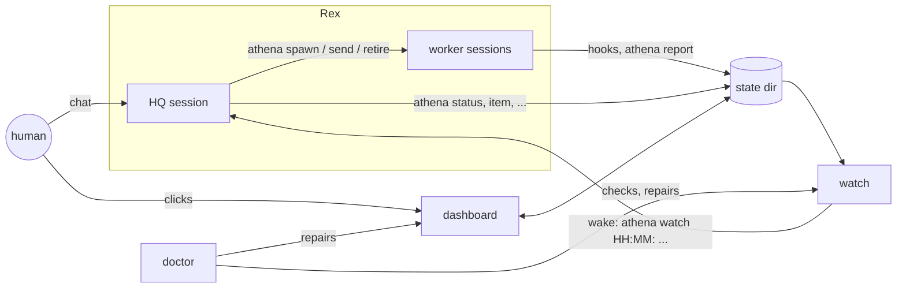

# athena architecture

athena runs a fleet of Claude Code sessions on a Mac, inside the Rex terminal app. One session, **HQ** (the chief of
staff), takes work from the human and hands each piece to a **worker**: a Claude Code session with its own git worktree,
Rex window, brief and `/goal`. HQ supervises the workers until their pull requests are ready, and brings the human only
what needs them.

Everything else is plumbing around those sessions:

- **`athena`**, a command line in plain Python, which HQ, the workers, the background jobs and the menu bar all call;
- **background services**, all under one launchd job: the **watch** (turns state changes into notices for HQ), **doctor**
  (checks and repairs), the **dashboard** (a local web page for the human) and the **menu bar** app;
- **hooks** that Claude Code runs in each session athena starts, which record what the session is doing and hold a
  worker's turn open until it files a report;
- **the state dir**, where all of it meets: plain files that every part reads and writes.



Rex runs the sessions; athena starts Claudes in them, reads their screens and types into them, but never keeps a Claude
alive itself. Nothing in athena is a server that the sessions depend on: if every athena job stops, HQ and the workers
keep running.

## The parts

| Part | What it is for |
|---|---|
| `bin/athena` | The command. A shell script that guards the state dir for lab workers, then runs the CLI on the system Python. |
| `athena/cli.py` | Finds the capability that owns a verb, importing as little as it can. |
| `athena/kernel/` | What every capability builds on: the state dir, the ledger, the event bus, config, the backend interface, starting and typing to a Claude, git, the machine budget, the capability contract, modules, and the door to the outside world. It names no capability (`tests/test_kernel.py` checks that). |
| `athena/backends/` | Where programs run: `rex.py` drives Rex; `fake.py` is the tests' stand-in. |
| `athena/caps/` | The capabilities: each command, check, background job and watch source is one file or package here. |
| `athena/modules/` | Optional modules shipped with athena (`clamshell`, `revive`), loaded like capabilities when on. |
| `prompts/` | `hq.md` and `worker.md`, appended to HQ's and each worker's system prompt; `worker-pi.md`, a Pi worker's. |
| `plugin/` | The plugin HQ loads: the `athena` skill (`plugin/skills/athena/SKILL.md`, HQ's procedures) and `never-ask.md`. |
| `worker-plugin/` | The plugin each worker loads: a Claude Code mod that draws the worker's progress band. |
| `pi-extension/` | `athena.ts`, the Pi extension a Pi worker loads with `-e`: its hooks, report gate and inbox. |
| `menubar/` | The menu bar app, in Swift, built on the Mac by `menubar/build.sh`. |
| `scripts/` | `test.sh` (the only way to run the tests), `smoke.sh` and `chaos-rex.py` (runs against a private Rex server), `scratch-state.py` (a sanitized copy of a state dir), `measure.sh` (timings of the hot paths), among others. |
| `tests/` | The unit and contract tests, run in a sandbox with an isolated HOME and the fake backend. |
| `docs/` | Longer pages on single parts, linked from the sections below. |

## The CLI and the kernel

**`bin/athena`** (`bin/athena`) is a POSIX shell script. When `ATHENA_WORKER` starts with `rex-` (a lab worker), it
refuses any state dir that is the live one or lies inside it (a hook just exits quietly), before Python starts. It then runs
`${ATHENA_PYTHON:-/usr/bin/python3} -I -S` with the repository first on `sys.path` and bytecode turned on, and calls
`athena.cli.main()`.

**`athena/cli.py`** resolves the verb through `caps.find_command` (`athena/kernel/caps.py`): first a capability named
like the verb (or the verb plus `s`), then every enabled capability, then active modules. Only the capability that owns
the verb is imported when the verb is named like it, so the hot commands cost what they use; any other verb loads
capabilities in order until one owns it. `athena` with no verb is `athena hq`. A full disk ends a command
with `disk is full` rather than a traceback.

The kernel (`athena/kernel/`):

| File | What it holds |
|---|---|
| `store.py` | The state dir (`~/Library/Application Support/athena`, or `ATHENA_STATE_DIR`): atomic JSON writes, appended lines that a torn write can't merge, `flock` locks (most under `locks/`; `ask.lock` and `doctor.lock` at the top of the state dir), and the trash, so nothing is deleted outright. |
| `ledger.py` | `ledger.jsonl`, the append-only record of every worker, and the state machines read from it: `LIFECYCLE`, `phase`, and the goal's moves (`GOAL_MOVES`). It also keeps a snapshot of the live workers in `run/ledger-live.json` and restores from it. |
| `bus.py` | `events.jsonl`: any process emits an event, readers follow it by byte offset. It rotates at 4 MiB, and `emit` never raises. |
| `config.py` | `config.json` in the state dir. Top-level keys (`model`, `effort`, `hq_model`, `hq_rotate_tokens`, `human_merge_repos`, Slack and CI keys, ...) and a `rex` block for the rest (`binary`, `server`, `caps`, `modules`, `dash_port`, `max_workers`, `claude` and `pi`, the two agents' commands, ...). A file that doesn't parse falls back to the last good copy, `run/config.good.json`. |
| `backend.py` | The session backend interface: create a session or window, read a screen, type, press a key, close, label, follow events. |
| `agents.py` | A Claude (or a Pi) in a place, independent of the backend: start it from a launcher, read what state it is in, type to it safely (a Pi: post to its inbox), make it exit, kill it. |
| `gitops.py` | Git for what guards a launch and a removal: preflight, worktrees, unsaved work, backup refs under `refs/athena-backup/`, git-ignored work. Reads take no optional locks. |
| `budget.py` | The machine budget checked before a launch: free memory, free disk, load. |
| `caps.py` | The capability contract, discovery and loading. |
| `modules.py` | Optional modules: which are listed, where they live, which are switched off. |
| `world.py` | The one door to real side effects, shut unless the state dir's own config opens it. |
| `lab.py`, `sandbox.py`, `canary.py` | The lab guard on the state dir, the opt-in signal sandbox for Claudes athena starts, and the tests' tripwire. |

## Capabilities

A capability is a module or package in `athena/caps/` with `SUMMARY` (one line) and `commands()`, which returns
`{verb: Command}`. It may also define any of these, each found by name (`athena/kernel/caps.py`):

| Function | What it gives | Who calls it |
|---|---|---|
| `checks(ctx)` | `[Check(name, ok, detail, repair, grace, short, quiet)]` | doctor, which owns grace, backoff and the repair budget; a `quiet` check's repair that went through is upkeep, not a problem, and raises no notification |
| `services(ctx)` | `[Service(name, argv, every, keep_alive, interactive)]` | `athena services run`, the one launchd job's supervisor, which runs each as its child |
| `tick(ctx, now)` | watch lines | the watch, every loop |
| `on_event(ctx, event)` | watch lines | the watch, for each new bus event |
| `on_quit(ctx)` | a line to say, or `None` | `athena services stop`, once the watch is down |

Every capability found loads, unless `config.json`'s `rex.caps` lists which do. A capability reaches another only
through `ctx.cap(name)`, which is `None` when that one is absent, so leaving one out changes nothing else.

The capabilities, by what they are for:

- **Sessions:** `hq` (HQ's session, rotation, handoff), `spawn`, `send` (`send`, `nudge`, `keys`, `screen`), `retire`,
  `trust`, `brief`, `profiles`, `sessions`.
- **What the sessions say:** `hooks`, `report`, `rules`, `progress`, `limits`.
- **Following work:** `watch`, `prs`, `follow`, `reviews`, `slack`.
- **The human's view:** `status`, `items`, `dash/`, `board`, `flame/`, `menubar`.
- **Keeping it running:** `doctor`, `services`, `install/`, `config`, `modules`.
- **The Mac:** `workspaces`, `disk`, `heavy`.

`athena --help` lists every verb, and [docs/commands.md](docs/commands.md) covers the ones whose behaviour is more than
their help line.

## Rex, the backend

A **space** is a Rex session, a **window** is a tab in it, and a **block** is a terminal pane
(`athena/kernel/backend.py`). athena lays them out the way the human sees them in Rex's sidebar:

- **HQ** has its own session, whose session, window and block are all labelled `athena` (`config.hq_name()`, or
  `ATHENA_HQ`). HQ's session is moved to the front of the list.
- **Each repo** has one session, labelled with the repo folder's name, found or made by spawn and recorded in
  `run/repo-sessions.json`. Each worker is a window in its repo's session, labelled with the worker's name.
- The ledger records each worker's space, window and block.

A repo's session is every worker's on it, so a worker never renames it (REX-LABEL). Rex's own SessionStart hook tells
every Claude to `rex session rename` its session, which would show the whole repo's group under one worker's name, so
`prompts/worker.md` says never to, and athena's SessionStart hook (`athena/caps/hooks.py`, `NO_RENAME`) says it again to
each worker. Should a label drift anyway, the sessions tick (`athena/caps/sessions.py`)
puts each repo session athena made back to the label it was made with (the repo folder's name) and says so in one line. HQ's session and sessions athena
did not make are never touched. `athena sessions` lists every session on the server as `hq`, `worker`, `orphan` (athena
made it and every worker in it is gone) or `other`, which nothing closes.

`athena/backends/rex.py` drives Rex by running the `rex` command line (`rex.binary`, with `-S <server>` when
`rex.server` is set) as a subprocess for each call. A call that times out raises `timeout` rather than reading as a
server that is down. Blocks run their program directly, and stay open after it exits, so a crashed Claude leaves a
readable screen. Text is typed in pieces of 200 characters (`TYPE_PIECE`).

`athena/backends/fake.py` keeps its spaces, blocks, typed text and pressed keys in a JSON file and runs nothing; the
tests use it.

## HQ starting

Files: `athena/caps/hq.py`, `prompts/hq.md`, `plugin/`.

`athena hq` (the same as `athena hq open`, and `athena` with no verb):

1. Takes `locks/hq.lock`, so only one HQ starts on a state dir.
2. If HQ's Claude is already running, it only relabels and focuses HQ's session.
3. Otherwise it starts Claude in HQ's session (a new window in the recorded session if it still exists, else a new
   session), resuming HQ's last conversation when there is one (from `hq-start.json`, which HQ's SessionStart hook
   writes, else `hq.json`). The arguments are:
   - `--append-system-prompt-file prompts/hq.md`: the rules that never change;
   - `--plugin-dir plugin/`: the `athena` skill, which holds HQ's procedures;
   - `--settings settings/hq-rex.json`: HQ's hooks, its permission profile, `ATHENA_ROLE=hq`, and
     `"idleCompaction": false`;
   - `--model <hq_model>` when config `hq_model` is set (`hq open --model` wins over it); with `""`, the default, HQ
     runs on the user's Claude Code default.
4. Writes `hq.json` (backend, space, window, block, cwd, the Claude arguments, the conversation), keeping the last copy
   as `hq.json.prev`.
5. Once HQ is ready, types its routine prompt: load the athena skill, run `athena status`, check doctor shows the watch
   running, then report what is live. The skill's §1 is the rest of the session start.
6. `athena hq open` then runs a `doctor --fix` pass, starts the dashboard and opens the board, each skippable by a flag.

HQ's state (`hq.state`) is computed from `hq.json` and whether its Claude runs, never stored: `absent`, `running`,
`gone`, `gone-fresh`, `lost` or `unrecorded`. Doctor reports a gone HQ and never restarts it; `athena hq` opens it again
on its conversation.

## Spawning a worker and giving it its goal

Files: `athena/caps/spawn.py`, `athena/caps/brief.py`, `athena/caps/trust.py`, `athena/caps/profiles.py`,
`athena/kernel/agents.py`, `athena/kernel/budget.py`, `prompts/worker.md`.

HQ runs `athena spawn --name <name> --repo <repo> --branch <branch> --brief <file> --goal "<condition>"`. Spawn refuses before
it changes anything, and then builds the worker in order:

1. **Checks.** A valid name that isn't reserved, a config that parses, no fleet-wide usage limit, no worker the ledger
   has lost, a brief that passes `brief check` (`--skip-brief-check` overrides), a goal under the length limit, room in
   the machine budget, a clean git preflight, a worktree path that doesn't exist yet, and Rex up.
2. **Capacity.** Under `locks/spawn.lock`: at most `rex.max_workers` live workers (16; `--force` goes past it) and never
   more than `rex.hard_cap` (16). Then the `spawn` line goes into the ledger.
3. **Worktree.** `git worktree add` under `worktree_root/<repo>/<branch slug>`, then the repo's setup script if
   `repos/<repo>.setup` exists beside the config.
4. **Brief.** Copied to `briefs/<name>.md`, with the state dir's `preferences.md` added as PREFERENCES.
5. **Settings.** `settings/<name>.json`: the worker's environment (`ATHENA_WORKER`, `ATHENA_HQ`, `ATHENA_STATE_DIR`,
   `ATHENA_BRIEF`, and `ATHENA_REAPPROVAL` for repos in `reapproval_repos`), its hooks, its permission profile
   (`athena/caps/profiles.py`, plus any `rex.grants`), and cross-session messages accepted.
6. **Trust.** The repo's main checkout is marked trusted in Claude's config (below), so the launch never stops at the
   trust prompt.
7. **Launch.** Claude starts in a new window of the repo's Rex session with `--name`, `--model` and `--effort` (config
   `model` and `effort` unless given), `--settings`, `--plugin-dir worker-plugin` and
   `--append-system-prompt-file prompts/worker.md`. Spawn waits for it to come up, ready or blocked at a startup prompt;
   one that shows no state within 20 seconds fails the launch.
8. **Goal.** The goal is typed in as `/goal <condition> Your brief is <path>; read it first. ...`, with fixed clauses
   on how to file the report, what is out of scope and messaging HQ once. A worker that is still at a startup prompt
   gets its goal later, from spawn's watch tick, once it is ready.

A launch that fails after the worktree exists kills its Claude, closes its window and removes the worktree.

**A Pi worker.** `athena spawn --agent pi` runs Pi instead of Claude Code; Claude stays the default, and HQ is always
Claude. Spawn refuses `--ultracode` with it, and a `pi` (config `rex.pi`) that isn't on PATH. Pi runs its own default
model unless `--model` is given, which is passed as written. It gets no settings file, no Claude folder trust and no
worker plugin. Its launcher carries in its environment what Claude's `--settings` carries, and Pi starts with
`--session-id` (chosen at spawn, the ledger's `pi_session`), `-e pi-extension/athena.ts` and `prompts/worker-pi.md`.
The extension (below) is its hooks. Its goal, and every later message, goes through its inbox in words, as Pi has no
`/goal`. [docs/commands.md](docs/commands.md) has the details, and what a Pi worker lacks next to a Claude one:
Claude's permission classifier, the goal evaluator, subagents, the progress band, SendMessage and flame's figures.

**The launcher.** `agents.start` writes `run/<name>.sh` (mode 0700), which writes its own pid to `run/<name>.pid`, `cd`s
into the worktree and `exec`s Claude with its environment. Rex runs that script directly in the new block.

**The goal's moves.** The ledger records where each goal is (`GOAL_MOVES` in `athena/kernel/ledger.py`): `first` while a
first goal waits, `amended` while a goal HQ restated with `athena amend <name> "<condition>"` waits, and `unconfirmed`
from the moment it is typed until it is seen to land, then back to none. A worker that shows no turn within 30 seconds
of its goal leaves it unconfirmed, which wakes HQ. Each move holds `locks/<name>.goal.lock`, so an amend waits for
a send in flight. A goal waiting at a startup prompt is typed only once the Claude is ready; a goal spawn sends at once,
and an amended one, go in even while the worker works, as Claude queues what is typed while it works and a worker
looping on a goal may never be idle.

**Typing safely** (`agents.send`, `athena/caps/send.py`). Nothing is typed into a Claude that is blocked, not running or
still starting, into a block labelled for someone else, or into an input box holding text someone hasn't sent. Text goes
in pieces of 200 characters: Claude takes about 800 characters arriving at once for a paste, and a pasted `/goal` never
runs. `GOAL_MAX` is 3990 characters.

**Folder trust** (`athena/caps/trust.py`). Claude's trust prompt is answered by writing
`projects[<main checkout>].hasTrustDialogAccepted: true` into `~/.claude.json`, as Claude's own message names it. Claude
writes that file often, re-reading it under `~/.claude.json.lock`, so trust takes the same lock, changes the one key
and renames the file into place. A worktree follows its main checkout.

**The budget** (`athena/kernel/budget.py`). Spawn refuses a launch under 25% free memory (10 points more for each extra unit an
ultracode worker costs), under 10 GB of free disk, or at load above 3 per core. A reading it can't get counts as room:
this holds launches, it is not an interlock. `--force-budget` goes past it.

## Hooks, status and the report gate

Files: `athena/caps/hooks.py`, `athena/caps/report.py`, `athena/caps/rules.py`, `athena/caps/progress.py`,
`athena/caps/status.py`, `worker-plugin/`.

Every Claude athena starts gets its hooks from its own `--settings` file; nothing is installed globally. Each hook runs
`bin/athena hook` with the event on stdin:

| Event | What it does |
|---|---|
| `SessionStart`, `UserPromptSubmit`, `Stop`, `SubagentStop`, `StopFailure`, `Notification`, `SessionEnd` | A worker's state, into `workers/<name>.json`; for HQ, its conversation id into `hq-start.json` and each prompt into the request log. |
| `Stop` (workers) | The report gate, below. |
| `PreToolUse` on Bash | `rules.py`: the standing orders a machine can check. |
| `PostToolUse` on the task tools | `progress.py`: the worker's progress, from the task list it keeps. |

**A worker's state** comes from one pure step, `hooks.next_state`:

```
starting -SessionStart-> idle -UserPromptSubmit-> working -Stop-> done | blocked | idle   (by the report)
any -Notification (needs the human)-> blocked        working -Notification (idle prompt)-> idle
any -SessionEnd-> exited
```

A turn that ends while its subagents or background shells still run shows as `working (background)`. Each write holds
`locks/<name>.hook.lock`, so a Notification beside a Stop can't lose the report.

**The report.** A worker files its report with a command, in its own session:

```
athena report --status DONE|DONE_WITH_CONCERNS|IN_PROGRESS|BLOCKED|NEEDS_CONTEXT --verify "<command> -> pass|fail" \
  [--decision "..."]... [--concern "..."]... [--summary "..."]
```

`report.py` fills in `head` from the worktree and `pr` from the branch's open PR, runs the gate's checks at once (a
DONE the gate would refuse is not filed, and the worker hears why), and writes the report into its status file as
`filed`.

**The gate.** At each worker Stop, the hook takes in what was filed this turn and moves it to `report`, the one field
that status, the watch, review and the dashboard read. It sends the turn back (`decision: block`, with the reason) when:

- nothing was filed this turn;
- a DONE or DONE_WITH_CONCERNS has no `--verify "... -> pass"`, its worktree is gone, its `head` is not the worktree's
  HEAD, or the repo is on GitHub and the report has no PR URL (unless the brief says no PR).

BLOCKED, NEEDS_CONTEXT and IN_PROGRESS need only the report; IN_PROGRESS rests as idle and wakes no one. Every Stop and
every new prompt uses up what was filed, so a turn sent back files again. The gate sends a turn back at most three
times in a row (the count resets after five quiet minutes); the next refusal gives way, and the worker reads as
`idle-unreported`, which wakes HQ. When nothing was filed, an
`ATHENA-REPORT {json}` line at the end of the worker's last message is read as its report.

**A Pi worker's hooks.** Pi reads no `--settings`, so `pi-extension/athena.ts` runs `bin/athena hook` itself with the same
events: `session_start` as SessionStart, `before_agent_start` as UserPromptSubmit, `agent_before_settle` as Stop (a `block`
becomes one more turn with the gate's reason), `session_shutdown` as SessionEnd, a bash `tool_call` as PreToolUse, and an
idle Notification when a run ends with no Stop. `next_state`, the gate and the rules are the same code. It also reads the
worker's inbox, `run/inbox/<name>/`, once a second: a message goes to Pi as the human's words, and a quit ends it.

**The transcript as a second source.** When a Stop event carries no last message, the hook reads it from the end of
Claude's own transcript, and `athena status` rebuilds a last report the same way when a status file is missing. Its
format is Claude's, so anything unexpected is simply no report.

**Rules** (`athena/caps/rules.py`). The PreToolUse hook reads each Bash command line as a shell would (each command
after `&&`, `;` or a newline, in a subshell, under `sh -c` or `eval`; quoted words are not commands) and denies, with
`athena rule: <why>`:

- `git push` with `--force`, `-f` or a `+ref` (use `--force-with-lease`);
- a push to `main` or `master`;
- `gh pr merge --admin`;
- `rex server stop` without `-S`.

It guards against mistakes, not against a script: what a script does inside isn't on the line.

**Progress** (`athena/caps/progress.py`, `worker-plugin/`). The PostToolUse hook turns each task-list update into done,
total and the step in progress, in `workers/<name>.progress.json`. The worker plugin's mod
(`worker-plugin/hooks/progress-mod/`) draws it as a band above the worker's prompt. When the list has been quiet for ten
minutes while the worker works, the mod asks `athena progress` for a short Haiku estimate instead (`rex.progress_haiku:
false` turns that off).

**Status** (`athena/caps/status.py`). `athena status` reads the ledger, the status files, the pid files and `ps` (one
call for every worker), with no backend call unless `--live`, so it answers in milliseconds. A Claude whose pid is gone reads as `exited`. A `ps` that can't
answer raises `Unknown`, which never reads as gone. Pi sets its process title to `pi`, hiding its `--name`, so a Pi
counts as its worker's only under the pid its extension wrote to `run/<name>.pi.json`. Pi reports its own state to Rex
(OSC 7501), read through `program_status` as Claude's is.

## The watch and its notices

Files: `athena/caps/watch.py`, `athena/caps/follow.py`, `athena/caps/prs.py`, `athena/caps/slack.py`,
`athena/caps/sessions.py`, `athena/caps/limits.py`; [docs/watch.md](docs/watch.md).

The watch (`athena watch --tagged --wake`) is a long-running process, a kept-alive child of the services supervisor. It holds
`locks/watch.lock`, so only one runs. Every loop (20 seconds by default) it:

1. folds the workers (ledger, status files, PRs) into a snapshot and diffs it against the last one;
2. reads new events from the bus;
3. calls every capability's and module's `tick` and `on_event`;
4. prints each resulting line, and types the ones that need HQ into it.

Each line is `wake`, `routine` or `quiet`, decided where it is made. Routine lines go to the watch's log; quiet ones go to
`logs/watch-suppressed.log` with their reason; a wake repeated within ten minutes is dropped (Slack's lines excepted). A
capability whose `tick` raises becomes a `watch error` line, not a dead loop.

**A wake** is typed into HQ as one prompt, `athena watch HH:MM: <line> · <line> · ...`, and only while HQ is idle with an
empty input box; until then the lines are held. Each line is rebuilt from an allowlist of fixed shapes (names, states,
report and check words, `#n`) before it goes out, and a line that fits none goes out as `a watch line not shown here
(athena status)`. HQ reads a typed prompt as the person's own words, so nothing from a PR, a ticket or Slack is ever
typed into it. The lines also go to `run/inbox.jsonl`, which `athena watch --inbox` prints as data.

The snapshot, the bus offset, the lines already told and any held wakes are saved in `run/watch-state.json` each loop,
so a restarted watch carries on without telling anything twice. `athena doctor` restarts a watch whose loop hasn't come
round in five minutes.

**What it follows:**

- **Workers:** state changes (into blocked, exited or idle-unreported is a wake), reports (all but IN_PROGRESS), a
  worker gone from the ledger, a goal unconfirmed. Spawn's tick delivers pending goals.
- **Workers' PRs** (`prs.py`): checks, reviews, conflicts, and whose move each PR waits on (`prs.move`). GitHub is read
  on a thread of its own, so a slow GitHub never holds up the loop.
- **Beyond the workers' PRs** (`follow.py`), every two minutes on its own thread: stacked PR chains (`stack.json`,
  set with `athena stack`), retired workers' open PRs for two weeks, PRs asking the human for a review (for the
  dashboard), failed CI on each repo's default branch on our own commits (one incident per workflow, in `ci-failed.json`;
  `is_ours` decides, and other people's commits and scheduled runs only reach the suppressed log), main moving
  (config `watch_main_moved`), and AI reviewers' threads on every followed PR.
- **Slack** (`slack.py`), at most once a minute: new messages for the human in their DMs and watched channels, as
  `slack-new <id> <n>`, counting only what the human hasn't read. The token comes from the Keychain, through the door
  below.
- **Rex** (`sessions.py`): labels put back, sessions left behind. On its own thread the watch follows Rex's event
  stream, and acts when the human closes a worker's window: it retires that worker the safe way.
- **The account** (`limits.py`): a usage limit, an expired sign-in or an API outage, read from Rex's program status and
  the bottom rows of each worker's screen. It is noticed once for the whole fleet: a usage limit parks the fleet until
  its reset, and then each parked worker is told to carry on.
- **The dashboard's answers:** `dash-queue <n>` when the human answered something (below). The watch looks at the queue
  every second between loops, so an answer rings at once.

[docs/watch.md](docs/watch.md) covers closed windows, AI reviewers' threads and how Slack is read.

## Items and the dashboard

Files: `athena/caps/items.py`, `athena/caps/dash/`.

**Items** are everything asked of or promised to the human, in `needs-you.json`: a `decision`, `request`, `result`,
`promise` or `incident`, each with whose move it is next (`you`, `athena`, a worker, a reviewer, CI, ...). HQ files each
request the human makes as a named item (`athena item add`), puts each decision on the dashboard as an item with at most
a few options and a recommendation, and resolves an item once the human took the last step (`athena item done`). All
writes hold `ask.lock`, and a `needs-you.json` that doesn't parse is never overwritten. Items resolved more than a week
ago move to `items-archive.jsonl`. What the human types into HQ is logged to `requests.jsonl` by HQ's UserPromptSubmit
hook, with secret-shaped strings redacted, so `athena item check` can find requests no item holds.

**The dashboard** (`athena dash open`) is one page on `127.0.0.1` (port `rex.dash_port`, 2843), served by
`athena dash run` with the Python standard library (`server.py`; `state.py` reads the files, `view.py` places each row,
`page.py` renders it, `markdown.py` turns an item's body into safe HTML, `static/` holds the script, style and fonts). It reads the state files and writes only what the
human does on it: `actions.jsonl`, `needs-you.json` (Done, Snooze, Reopen) and `dismissed-prs.json`. The page groups:

- **Needs you:** decisions, with HQ's recommendation and a one-click answer; workers blocked at a permission prompt; PRs
  whose next move is the human's.
- **Ready for you:** results and reports to read.
- **Awaiting review:** PRs waiting on a teammate.
- **In flight:** every worker and what it is doing.
- **Done today:** what settled in the last 24 hours.

The page updates itself over server-sent events. It answers only to its own host names on loopback, sends a strict
Content-Security-Policy, and takes a POST only from its own origin with the token it was served.

**An answer's path.**

1. A click posts the answer, which the server checks against what the page offered and appends to `actions.jsonl` as
   `queued`.
2. For six seconds the human can undo it.
3. Once it settles, the watch rings `dash-queue <n>` in HQ.
4. HQ reads the answers with `athena ask queue`, acts on each in order, and runs `athena item done <id>`.

An answer not taken up within ten minutes shows its item again. A low-stakes decision filed with `--rec <option> --auto`
takes its recommendation on its own 12 hours after it was filed, or 2 hours once the human has been away, if they don't
object; never one with stakes (security, a customer, money, one-way).

The dashboard's Flame page (`/flame`, `athena/caps/flame/`) shows where time and tokens went, from an index of Claude's
transcripts that holds their shape and cost, never their text ([docs/flame.md](docs/flame.md)).

**The board** (`athena board`, `athena/caps/board.py`) is a read-only panel in a block beside HQ: a row per worker and
the tail of each busy worker's screen, redrawn from status. It is for a glance, never for typing.

## Doctor and services

Files: `athena/caps/doctor.py`, `athena/caps/services.py`, `athena/kernel/supervisor.py`.

**Doctor** is one stateless pass over everything athena needs. Its own checks are the Rex server, each running worker's
hooks, disk, memory, the ledger and the config; every other line comes from a capability's or module's `checks(ctx)`: the
watch, the dashboard, HQ and its context, PRs, Slack, items, workspaces, sessions, limits, modules, the installed release,
revive and clamshell. A `checks` that raises is one failing line, not a failed pass.

Doctor owns only the rules around a check:

- a failing check with a repair is repaired once its grace has passed (`grace`, 0 unless the check sets one);
- at most three repairs per check an hour, backing off 2 then 4 minutes between tries;
- no repairs while load is above 3 per core, since a repair only adds to it;
- no repairs without `doctor.lock`; on a full disk it still reports.

What it repairs: a watch whose loop stopped, a dashboard that isn't answering, a ledger that lost workers (restored from
its snapshot), an update left half-switched, an install still on one launchd job per service, and HQ's context (by
asking HQ, once every two hours while it is idle, to rotate). It never starts the Rex server, a worker's Claude or HQ: Rex runs those, and doctor only says what is gone.

Each pass writes `health.json` (each check, the problems and since when, what was repaired, and `hq_alive`) and keeps its
memory under the `rex` key of `doctor.json`. `athena doctor --last --json` reads `health.json` and runs nothing. With
`--fix`, a new problem also raises one macOS notification, repeated hourly while it lasts. The watch tells HQ once when
doctor hasn't reported for five minutes, so each of the two watches the other.

**Services** (`athena services install|uninstall|status|stop|start|restart|run`) runs every capability's and module's
`services(ctx)` under one launchd agent, `local.athena` in `~/Library/LaunchAgents`, so macOS shows one background item
and one notice. Its program is `athena services run`, the supervisor (`kernel/supervisor.py`), which starts each service
as its own child, in its own process group, logging to `logs/service-<name>.log` (the supervisor's own log is
`logs/services.log`):

| Service | Runs | How |
|---|---|---|
| `doctor` | `athena doctor --fix --quiet` | every 60 seconds |
| `watch` | `athena watch --tagged --wake` | kept alive |
| `dash` | `athena dash run` | kept alive |
| `menubar` | `athena menubar run` | kept alive, interactive |

A module may add services of its own; they run under the supervisor like these, and one added or removed is picked up at
the next `services install` or restart, as the supervisor reads them when it starts.

What launchd did for each job, the supervisor does for each child. A kept-alive child that exits non-zero or on a
signal starts again after a delay that doubles from 1 second up to 60, and goes back to 1 second once a run has lasted 60
seconds; a crash-looping child never holds up the others. A clean exit stays down until the supervisor next starts, as
launchd's `KeepAlive{SuccessfulExit: false}` did (the menu bar exits 0 when its app isn't built). An `every` child runs on
its interval; a run still going when its time comes is not started twice, and after a gap longer than the interval (the
Mac slept) it runs once. Each child holds a lock of its own (`run/services/<name>.lock`) while it lives, so a supervisor
that starts while a child of an earlier one still runs waits for it instead of starting a second copy.

The supervisor signals only children it started, through their `Popen` handle, and on TERM stops them all before it exits.
They stay in its process group, so launchd clears them with the job even if the supervisor is killed outright. It holds
`run/services.lock` while it runs, which is how anyone tells it runs, and says each child's state (starting, running,
backing off, waiting, stopped) in `run/services.json`, which `services status --json` reads for the menu bar. The CLI
reaches it only through launchctl (install, restart) or a file it polls:

- **Quit athena** (`services stop`) writes `services-stopped.json`, naming what `athenas()` names: doctor first (so
  nothing brings the rest back), then the watch and the dash. The supervisor stops those, in that order, and keeps them
  stopped across a login while the mark is there. `stop` waits for it, stops a watch doctor started when no supervisor
  ran, and runs each loaded capability's and module's `on_quit`. The supervisor, the menu bar and a module's services
  stay. `services start` takes the mark away, and the supervisor starts them again, doctor last. With no supervisor
  running, stop and start say the same lines, and start loads the one job. Quit never stops the Rex server, HQ or any
  worker. While stopped, doctor's watch and dash repairs stand back, as a repair would undo Quit.
- **Doctor's repairs** of the watch and the dash write `run/services-ask/<name>`: the supervisor restarts that child now
  and clears its backoff. Only with no supervisor running does a repair (or `dash on`) start a copy of its own, so a
  repair never races the supervisor for the dash's port or the watch's lock.

`services restart` is launchd's `kickstart -k` of the one job: the supervisor and every child restart on the code
`current` names. It first builds that release's menu bar app if it is missing or stale, as a release is copied without
its build and `menubar run` exits clean (and stays down) without one. Run by a child of the supervisor (doctor, the menu bar), it ends that caller too, after launchd has it.
While athena is stopped it still restarts the supervisor, and the mark keeps the rest stopped.

The one job is `ProcessType` Interactive, as the menu bar app is one of its children; the supervisor puts every other
child under darwin's background policy, as `ProcessType` Background did for its own job. A plist whose bytes haven't
changed is left as it is, since each write shows the human a notice.

**The layout before the one job** was one launchd job per service, `local.athena.<name>`. `services install` boots out
and removes each, the old doctor's last, after the one job is loaded, and keeps the environment they carried. An update
to this layout's first release runs the old release's updater, which only restarts the old jobs onto the new code and asks
the new doctor for its verdict; so the move is doctor's `services` repair, which starts `athena services install` in a
session of its own and does not wait for it (it may build the menu bar app first, and it ends the old doctor job). It
waits while an update holds the install lock or has a switch on record. The move is upkeep, not a problem. Its state
comes from two things alone: `locks/services-move.lock`, which the install holds while it runs, and its record
`services-move.json`, written running when the install takes the lock, failed with what went wrong when it raises or
leaves old jobs, and removed once the move is done. Not started is a quiet repair (no notification when it goes
through); under way is ok, however long the menu bar app takes to build; failed (a try killed outright included) is an
ordinary problem, told once and hourly after; retrying after a failure stays failing and starts no second try. Until
the move, `stop`, `start` and `restart` act on the old jobs as they did. A rollback (`install --rollback`, or an update's own) to a release without the
supervisor hands its layout back: that release's own `services install` writes its jobs, then the one job goes.

## The menu bar

Files: `athena/caps/menubar.py`, `menubar/`.

The menu bar app is an AppKit status item in Swift (`menubar/Sources/`), built by `menubar/build.sh` with `swiftc` into
`menubar/build/AthenaMenu.app`. `services install` builds it when it is missing or its sources changed (by content
hash), and the services supervisor runs `athena menubar run` as its child, which hands over to the app. It adds no
background item of its own: macOS counts the one launchd job, not the processes it starts.

The app does everything through the CLI, so it never names launchctl or the Rex server. It polls `services status
--json`, `status --json` and `modules --json` every 5 seconds, one poll at a time, and `doctor --last --json` at most
every 30 seconds. It acts with `services stop|start|restart`, `dash open`, `hq open`, `doctor --fix --quiet` and
`modules action <name> <id>`. Its icon, a knot, shows athena working, idle, needing the human or stopped
(`menubar/glyphs/`); the working motion is drawn in Swift from the strands of `knot-working.svg`.

## Modules

Files: `athena/kernel/modules.py`, `athena/caps/modules.py`, `athena/modules/`; [docs/modules.md](docs/modules.md).

A module is an optional feature: a folder with `manifest.json` and `__init__.py`. Once loaded it is a capability like
those in `athena/caps/`, plus a menu bar entry. Public modules live in `athena/modules/`, and private ones in
`rex.modules_dir` (`~/.config/athena/modules` by default), outside the repository. A name found in both is an error.

- Config's `rex.modules` lists the modules to load; a public module whose manifest says `"default": true` loads too.
- `athena modules load|unload <name>` changes the list; a module switched off stays listed, off, in `modules.json`.
- `athena modules --json` is the menu bar's list, one object per module (`name`, `title`, `public`, `loaded`, `state`,
  `detail`, `actions`).
- A module's `services(ctx)` run under the services supervisor like the core ones, as children of the one launchd job;
  Quit athena leaves them running.

The two public modules:

- **revive** (on by default): when the Rex server restarts, every pane comes back as a plain shell. Revive brings HQ
  back first, then each live worker, in its own pane, on its own conversation (`--resume`; a Pi worker's launcher
  already names its `--session-id`), with the flags it was started with, and tells a worker that was mid-turn to carry on. `athena revive` shows what a restart now would bring
  back. It records each server instance it handled in `revive.json`.
- **clamshell** (off by default): whether the Mac stays awake with its lid closed. It decides from AC power, the lid and
  doctor's last pass in `health.json` (`decide`, a pure function), and runs `caffeinate` while a worker works on AC
  power. The privileged side is a root daemon outside this repository, which reads `hq_alive` from `health.json`.

## HQ rotation and handoff

Files: `athena/caps/hq.py`, `plugin/skills/athena/SKILL.md` §1a.

A long HQ conversation is not compacted: it is ended and a fresh HQ starts from a handoff. HQ's `--settings` set
`"idleCompaction": false`, so Claude Code never compacts HQ while it sits idle. `autoCompactEnabled` is left to the user,
as a backstop near the limit. Workers' settings leave compaction alone.

**When.** HQ rotates once its context holds config `hq_rotate_tokens` (400k unless set), counted from the last usage in
HQ's transcript. `athena status` and `athena doctor` show it as `hq context 171k of 400k (rotates at hq_rotate_tokens)`,
and doctor asks HQ to rotate once it is past the line, at most every two hours, only while HQ is idle with an empty
input box. HQ also rotates daily, by the skill. Nothing rotates HQ by force: HQ runs the command.

- `athena hq rotate` rotates now.
- `athena hq rotate --if-context-over` rotates only past `hq_rotate_tokens`, and says why not otherwise.
- `athena hq rotate --if-context-over <pct>` measures a percent of `rex.hq_context_window` (1M unless set;
  `ATHENA_HQ_CONTEXT_WINDOW` overrides) instead.

**How.**

1. HQ writes its in-flight threads (what it waits on, promises, a review in progress), passed with `--threads -` or kept
   in `threads.md`; without them, HQ's last words from its transcript stand in.
2. `build_handoff` writes `handoff.md` from athena's state: the fleet, PRs, every open item by name (never cut), the
   threads, the notes tail and the standing orders' path, at most 150 lines.
3. The rest runs detached (`logs/hq-restart.log`), since HQ asked from its own Bash tool. It waits up to two minutes for
   HQ to be idle with an empty input box, else skips; `/exit`s HQ's Claude; starts a fresh one in the same session,
   with no `--resume`; and types a prompt telling it to read `handoff.md` and run the session start.
4. The old conversation stays resumable, recorded in `hq.json` as `previous_session`, and `threads.md` moves to
   `threads.prev.md`.

A rotation is refused during a usage limit or right after an account change. Workers, the dashboard and the watch keep
running through it.

## Retire and workspaces

Files: `athena/caps/retire.py`, `athena/caps/workspaces.py`, `athena/caps/disk.py`, `athena/kernel/gitops.py`;
[docs/workspaces.md](docs/workspaces.md).

`athena retire <name>` moves through `saved -> marked -> stopped -> removed -> closed -> retired`. No stage is stored:
each run asks the world what is left, so a retire that was killed is finished by running it again.

1. **Saved.** The head is backed up under `refs/athena-backup/<name>/`. Uncommitted, unpushed or git-ignored work
   refuses the retire. `--force` saves it first: changes, untracked files included, as a `-wip` backup ref, and
   git-ignored work copied to `trash/`, up to `rex.ignored_copy_max_mb` (2 GB). A save that fails stops the retire.
2. **Marked.** The ledger records where the work went (`retire_kept`) and that the worker is retiring.
3. **Stopped.** Claude is asked to `/exit` (a Pi, to quit through its inbox), then its block is closed, then it is killed; whatever else it left running
   on its terminal is stopped too, listed before the stop.
4. **Removed.** `git worktree remove`. It adds `--force` only once the changes are saved as a `-wip` ref, or on a
   `retire --force` that needs it, so git still refuses a dirty tree nobody saved.
5. **Closed.** Its window closes, and its repo's session once that is empty.
6. **Retired.** A line in `history.jsonl` and in the ledger. The branch stays.

`athena workspaces` lists every worktree, Claude worktree, scratchpad, scratch space and leftover in the state dir, with
an owner and a state computed from facts on every read (`workspaces.classify`: active, crashed, retired, orphan,
expired, held). `athena workspaces clean --apply` removes only what holds no unsaved work, backing up a worktree's head
first and moving anything else to `trash/`. `athena disk` lists named caches and empties one by name.

## Install and update

Files: `athena/caps/install/` (`__init__.py`, `releases.py`, `update.py`).

`bin/athena install` (from a checkout the first time) makes a release: a whole copy of the shipped files under
`~/.local/share/athena/releases/<version>-<content hash>`, and a `current` link swapped atomically by one rename.
`~/.local/bin/athena` is a small launcher that `exec`s through `current`. Everything athena hands out by path (hooks, prompts,
the launchd job) goes through `current`, so a running Claude's hook never sees a half-copied tree. Two releases are kept.
Install writes nothing in `~/.claude`, since hooks and permissions go in each session's own `--settings`, and never edits
a shell profile: it prints the line to add.

- `--check` reports the release, the launcher, `PATH` and the permission profiles; `--dry-run` changes nothing;
  `--rollback` goes back to the previous release; `--uninstall` removes the jobs, the launcher and the releases and
  keeps the state.
- `--services` also installs the launchd job, `local.athena`, whose supervisor runs every service.
- `--real-world` opens the door to real side effects on a state dir that lacks it; a state dir install creates gets it.

`install.json`, beside the releases, is the one record of what runs: the current and previous release, where updates come
from and on which channel, a switch under way, what the repository last offered, and how the last update ended. Nothing is
read off the folder or the link alone.

**`athena update`** fetches the repository into a clone of its own, takes the newest `vX.Y.Z` tag above the running
version (or main's head with `--channel main`; never an older version), makes the release beside the running one,
records the switch, swaps `current`, restarts athena's launchd job (a release still on one job per service restarts each
of those), and asks the new release's doctor. Any check that
passed before and fails now, a doctor that doesn't answer, or a SIGTERM swaps back. A switch left on record by a killed
update is undone by the next update or by doctor's `update` check, which otherwise only says which version runs and
whether a newer one is out (one `ls-remote` a day).

## State on disk

The state dir is `~/Library/Application Support/athena`, or `ATHENA_STATE_DIR`. The main files, and who writes them:

| Path | Writer | What it holds |
|---|---|---|
| `config.json` | the human, `athena install`, `athena modules` | config: top-level keys, and the `rex` block |
| `ledger.jsonl` | `spawn`, `retire`, the kernel's `ledger.py` | every worker's lifecycle, append-only |
| `events.jsonl` | `kernel/bus.py` | the event bus |
| `history.jsonl` | `retire` | retired workers |
| `workers/<name>.json` | `hooks`, `report` | a worker's state, last report and filed report |
| `workers/<name>.progress.json` | `progress` | a worker's progress band |
| `briefs/<name>.md` | `spawn` | each worker's brief |
| `settings/<name>.json`, `settings/hq-rex.json` | `spawn`, `hq` | each session's `--settings` |
| `hq.json`, `hq.json.prev`, `hq-start.json` | `hq`, HQ's SessionStart hook | where HQ runs and on which conversation |
| `handoff.md`, `threads.md` | `hq rotate`, HQ | the rotation's handoff and in-flight threads |
| `needs-you.json`, `items-archive.jsonl`, `actions.jsonl`, `requests.jsonl` | `items`, the dashboard | items, old items, the dashboard's answers, the request log |
| `dismissed-prs.json` | the dashboard | PR rows the human dismissed |
| `health.json`, `doctor.json` | `doctor` | the last pass, and doctor's memory |
| `watch.json` | `watch` | workers, PRs, review requests and stacks, for the dashboard |
| `stack.json`, `open-prs-posted.json`, `ci-failed.json` | `prs`, `follow` | stacked PRs, posted PRs, CI incidents |
| `slack-rex.json` | `slack` | each conversation's cursor |
| `service-rex.json`, `services-stopped.json` | `services` | the services installed, and Quit's mark |
| `board-rex.json` | `board` | where the board's block is |
| `modules.json`, `revive.json` | `modules`, revive | modules switched off; Rex instances handled |
| `run/` | many | runtime state: launchers and pids, a Pi worker's `<name>.pi.json` and `inbox/<name>/`, `repo-sessions.json`, `sessions.json`, `ledger-live.json`, `config.good.json`, `watch-state.json`, `inbox.jsonl`, `follow.json`, `closes.json`, `limit.json`, `dash.json`, and the services supervisor's `services.json`, `services.lock`, `services-ask/` and `services/<name>.lock` |
| `flame/index.sqlite` | `flame index` | the Flame page's index |
| `scratch/<owner>/<name>/` | `athena scratch new` | disposable work with an owner and a ttl |
| `locks/`, `ask.lock`, `doctor.lock` | `store.locked` | `flock` files |
| `logs/` | services, hooks, the watch | job logs, `hook-errors.log`, `watch-suppressed.log`, `hq-restart.log` |
| `trash/<date>/` | `store.to_trash` | anything athena removes |

Outside the state dir: the releases and `install.json` under `~/.local/share/athena/`, the launcher at
`~/.local/bin/athena`, the launchd job `local.athena.plist` in `~/Library/LaunchAgents`, and each worker's worktree
under `worktree_root`.

## The door to the outside world

Files: `athena/kernel/world.py`, `athena/kernel/lab.py`, `athena/kernel/sandbox.py`, `bin/athena`.

`world.py` is the only way to run `security`, `osascript`, `pmset`, `ioreg`, `caffeinate`, `launchctl` or `gh`, or to
reach Slack or a module's card on a mounted volume. The door is shut by default. It opens only when `config.json` in the
state dir itself says `rex.real_world: true` (`ATHENA_CONFIG` can't point it elsewhere), and never while
`ATHENA_WORKER` starts with `rex-`. No environment variable opens it: a test harness that dropped one would otherwise open
the door to the tests. With the door shut, the only Rex server that may be named is a private one under the per-user
scratch root, marked with this state dir. `ps`, `git`, `du` and `memory_pressure` stay outside the door: they only read.

**The lab guard** (`lab.py`, and its shell copy in `bin/athena`) keeps a lab worker (one whose `ATHENA_WORKER` starts with
`rex-`) off the live state dir: it refuses the live paths, anything holding them and anything under the real home.
Places are compared by what they are, not how they are spelled: links followed, case ignored, and by device and inode.
`install --lab-guard-out` takes the guard out of an installed copy alone, never out of a checkout.

**The signal sandbox** (`sandbox.py`), when config sets `rex.signal_sandbox: true`, runs each Claude athena starts under a
`sandbox-exec` profile that lets it signal only what it started, so a stray `kill` can't reach HQ, other Claudes or Rex.
A launch whose sandbox can't start is refused.

## Tests

Files: `scripts/test.sh`, `tests/harness.py`, `athena/kernel/canary.py`.

Tests run only through `scripts/test.sh`, behind four walls:

1. **An OS sandbox** (`sandbox-exec`) for the test process and every child: no writes under the real HOME or
   `/Volumes`, no reads of live state or Claude's files, none of the real tools, Rex or Claude, no network but loopback
   and not the live dashboard's port, no signals outside. The harness stops at import unless a write the sandbox forbids
   fails with `EPERM`, so the suite refuses to run bare.
2. **The door is shut**, and each test ends by checking it still is.
3. **Stubs**: the door's tools resolve to recording stubs first on `PATH`, `ps` is a fake, the backend is the fake one,
   and HOME and the state dir are marked scratch folders.
4. **A canary**: a Python audit hook in the test process and its `bin/athena` children records any reach for a real
   tool, a guarded path, the network or a foreign signal, and the harness fails any test whose log has an entry, even if
   the test swallowed the error.

The services supervisor is tested with fake children (`tests/fixtures/fake_child.py`, and the `fake-services` fixture
module for the real `athena services run`), never the real dash, watch or menu bar, and launchd is a stub that remembers
what it loaded. Each fake child holds a lock while it lives, and each test ends by checking every one is gone. The upgrade
tests run the tagged `v1.0.0`, the last release with one job per service, against this tree.

`scripts/smoke.sh` runs real Claudes through spawn, status, send, the report gate and retire on a private Rex server
and a scratch state dir. `scripts/chaos-rex.py` runs the [chaos catalogue](docs/chaos.md)'s cases that need real
processes, on a private server.

## Design reasons

Why the parts are the way they are:

- **Python standard library on the system Python.** Nothing to compile or install, and a command starts fast enough to
  run in every hook. `bin/athena` runs it with `-S` and keeps bytecode on, which Xcode's Python turns off by default.
- **Claude starts from a launcher script, never typed into a shell.** The pid is athena's whichever backend ran it, and
  nothing depends on a shell prompt, its line limit or its history.
- **Hooks go in each session's `--settings`.** They fire only in a Claude athena started, so a Claude started from a
  Bash tool, or one in a matching folder, can never report as a worker.
- **Status is files first.** `athena status` costs file reads and a `ps`, so HQ, the menu bar and the watch can ask
  often. Liveness has three answers: running, gone, and unknown, which never reads as gone.
- **State machines are explicit and computed, never stored**: a worker's lifecycle and phase (`ledger.py`), its goal
  (`GOAL_MOVES`), its activity (`hooks.next_state`), HQ (`hq.state`), a workspace (`workspaces.classify`), whose move a PR
  waits on (`prs.move`), clamshell (`decide`). A computed state can't drift from the record it comes from.
- **The watch is its own process.** A slow GitHub or a failed loop never costs HQ a turn or a restart, and doctor
  restarts the watch alone.
- **A wake is typed only from fixed words.** HQ reads a typed prompt as the human's own, so a line is rebuilt from an
  allowlist before it goes out, and nothing a PR, ticket or Slack message says reaches HQ that way.
- **Rex runs the sessions.** Doctor never brings a Claude back or starts the Rex server; it says what is gone. A worker
  or HQ comes back through Rex (`athena hq`, revive) or is retired.
- **Slow is not dead.** A Rex call that times out raises instead of reading as down, and doctor holds every repair while
  load is above 3 per core, so a starved Mac gets flags, not actions.
- **The budget holds launches, the fleet's size alone does not.** A fleet that counts only itself can take the Mac down.
- **Text is typed in pieces of 200.** About 800 characters at once reads as a paste, and a pasted `/goal` doesn't run.
- **The gate checks a PR's URL, not GitHub.** A hook has seconds and the API quota is shared; the watch's own fetch sees
  the real PR.
- **On a full disk the gate outranks the lock.** The hooks and doctor's look run without the lock they can't create, as
  a gate that stops working turns off every report check; nothing that decides (two HQs, capacity, the heavy slot) runs
  on a lock it doesn't hold.
- **A broken config with no good copy refuses.** Defaults would quietly change what HQ may do, so HQ and spawn stop and
  say so.
- **A lost ledger comes back from a snapshot** doctor keeps beside it, and no launch happens until it has.
- **Limits are read from the bottom of a screen**, only when a worker isn't working, only in the last 12 rows, and only
  as a row of their own, so a worker discussing limits never parks the fleet. It is the weakest input athena has, and a
  miss only means reading as idle.
- **Checkable orders are a hook, the rest are prose.** A permission profile's rules match only how a command starts;
  `rules.py` reads every command on the line.
- **A release is a whole copy behind one link,** so an update or a rollback is one rename, and a running hook never sees
  half of each.
- **The menu bar does everything through the CLI,** so the door and the lab guard hold for it too.
- **Real side effects have one door, shut by default,** so a test, a scratch copy or a lab worker can't reach the Mac's
  power, keychain, launchd, Slack or GitHub by accident.
