<picture>
  <source media="(prefers-color-scheme: dark)" srcset="assets/logo-lockup-dark.svg">
  
</picture>

**A chief of staff that runs your Claude Code workers.**

> [!NOTE]
> athena currently supports only macOS, Rex (in closed beta) and Claude Code.

**[Install](#install)** · [Getting started](#getting-started) · [Features](#features) · [Requirements](#requirements) · [Read more](#read-more)

Athena is one Claude Code session that's active 24/7. It remembers everything, wakes itself up when needed, and delegates all work aggressively to its sub workers. Tasks are handed down to top level Claude Code workers, which athena creates, monitors and cleans up when they're done. It makes sure they don't get stuck, answers their questions and pings you only when you're really needed.

<p align="center">
  
</p>

## What athena is

- **It sits on top of Rex**\
  athena opens a chat of its own there, called **athena HQ**: your chief of staff.
- **You talk to HQ**\
  Give it a Linear ticket, a question or a chore. HQ gets it done.
- **HQ delegates**\
  Each task gets a worker: a Claude Code session with its own `/goal`, git worktree and Rex window. HQ watches it and answers its questions.
- **HQ runs the whole ticket**\
  Spec, build, test, review, watching CI, getting the pull request ready, and cleaning up the worker once it is done.
- **It runs around the clock**\
  athena lives in the background and keeps its state on disk: every worker, every pull request, every open question. A restart, a reboot or a fresh HQ picks up where things were. Nothing is forgotten.
- **Everything that needs you is on the dashboard**\
  Decisions, permission requests, finished work and pull requests waiting for you, all in one place. A decision takes one click.

## How it works

<p align="center">
  
</p>

1. **Ticket.** You hand HQ a Linear ticket. Each worker's branch is named after it.
2. **Spec.** HQ writes a brief: the goal, what is in and out of scope, how to prove it is done, and what the worker
   must never do without you. Then it starts a worker with the brief and a `/goal`, a condition Claude Code keeps
   working toward until it is met.
3. **Build and test.** The worker writes the code, runs the checks the brief names and opens a draft pull request.
   Then it files a report. A worker cannot just go quiet: a turn that ends without a report is sent back to it.
4. **Review.** HQ checks the worker's claim against git and the pull request. Then a fresh reviewer, one that did not
   write the code, reads the change. Findings go back to the worker until it passes.
5. **CI checks.** HQ follows the pull request's checks and review threads, and sends anything that fails back to the
   worker.
6. **Merge.** Rebased on main, checks green, threads answered: HQ tells you the pull request is ready. You merge it,
   or tell HQ to.
7. **Clean up.** HQ retires the worker. It saves the work, closes the window and removes the worktree. The branch stays.

All along, HQ watches every worker and answers what it can. It brings you only what is yours: a permission, a
security or scope call, a merge.

### Where you come in

<p align="center">
  
</p>

The dashboard (`athena dash open`) is your inbox for the whole fleet:

- **Needs you:** decisions, each with HQ's recommendation and a one-click answer, and permission requests and merges waiting on you.
- **Ready for you:** results and reports to read.
- **In flight:** every worker and what it is doing now.
- **Awaiting review:** pull requests waiting on a teammate's review.
- **Done today:** what was settled.

### Always on

<p align="center">
  
</p>

athena's background jobs start at login, check themselves and repair what stopped. If Rex itself restarts, athena
brings HQ and every worker back in their own windows, on their own conversations, right where they left off.

## Features

 **Never ask**\
athena does routine steps itself: rebases, CI reruns, cleanup, restarts. Security, money, scope, merges and anything one-way still come to you, with a recommendation.

 **Slack and GitHub monitors**\
Once Slack is connected, athena watches your DMs and the channels you pick. It also watches CI on main, reviews on every pull request and AI reviewers' threads. Something new wakes HQ; routine noise does not.

 **Dashboard, items and decisions**\
Every request becomes a named item you can follow. A low-stakes decision can take HQ's recommendation on its own if you don't object, and you can undo it.

 **Restore after a Rex restart**\
When Rex restarts, athena brings HQ and every worker back on their own conversations. It ships with athena and is on by default.

 **Fresh-eyes code review**\
Each finished pull request is read by a reviewer that did not write it. It blocks only on real problems: bugs, missed requirements, scope creep.

 **Merge preparation**\
HQ gets each pull request rebased, green and its threads answered, then tells you it is ready. It merges only on your go.

 **HQ rotation with a handoff**\
When HQ's conversation grows long, it writes a handoff and starts fresh from it. The workers keep running through it.

 **Doctor repairs itself**\
`athena doctor` checks every part athena needs. In the background it runs on its own and restarts whatever stopped.

 **Workers always report**\
A worker that stops without filing a report is sent back to file one, and HQ hears if it still doesn't. It can't call work done unless its checks pass on its latest commit.

 **Guard rails**\
Rules a machine can check, such as never force-pushing or pushing to main, are enforced before a command runs. Not just written in a prompt.

 **Menu bar**\
A knot in the menu bar shows at a glance whether athena is working, idle or needs you, and starts or quits it.

 **Modules**\
Optional features you load with `athena modules` and switch on and off from the menu bar, such as keeping the Mac awake with its lid closed. You can write your own.

Also in the box:

- **Usage limits, once**\
  A usage limit or an expired sign-in is noticed once for the whole fleet, not once per worker.
- **Safe cleanup**\
  Retiring a worker never loses work: unsaved changes stop it, and its last commit is backed up first.
- **Updates that roll back**\
  `athena update` keeps a new release only if it runs as well as the old one.
- **Flame**\
  A dashboard page that shows where athena's time and tokens went.

## Requirements

- **macOS.** athena runs on a Mac only.
- **[Rex](TODO), by Superlogical.** <!-- TODO: Rex link, the human supplies it --> Rex is currently in closed beta.
- **[Claude Code](https://claude.com/claude-code)**, signed in. A Claude Max or Ultra account is recommended.
- **[gh](https://cli.github.com)**, GitHub's command line tool, signed in.
- **Linear**, where HQ reads your tickets and the name of each branch.

## Install

```sh
git clone https://github.com/Delitefully/athena.git
cd athena
bin/athena install --services
```

The installer checks what it needs first and says what is missing. `--services` starts athena's background jobs at
login.

## Getting started

Open HQ:

```sh
athena hq
```

and tell it what to start, such as the Linear tickets you want built. Then:

- `athena dash open` opens the dashboard.
- `athena status` shows every worker at a glance.
- `athena doctor` checks that everything athena needs is running.
- `athena update` brings the newest release and keeps it only if it runs well.
- `athena install --uninstall` removes athena and keeps your state.

## Read more

- [Architecture](ARCHITECTURE.md): how athena is built, and why each decision went the way it did.
- [Changelog](CHANGELOG.md): what changed in each release.
- [Commands](docs/commands.md): the commands whose behaviour is more than their help line.
- [The watch](docs/watch.md): how athena watches workers and pull requests, and when it wakes HQ.
- [Modules](docs/modules.md): the optional modules, and how to write your own.
- [Worktrees and cleanup](docs/workspaces.md): worktrees and scratch spaces, and how cleanup never loses work.
- [Flame](docs/flame.md): the page that shows where time and tokens went.
- [Upgrading](docs/upgrade-from-herdr.md): moving over from athena's earlier, pre-Rex version.
- [Release review](docs/release-review.md): what was checked and fixed before the current release.
- [Chaos catalogue](docs/chaos.md): what can break at random, and what athena should do then.
