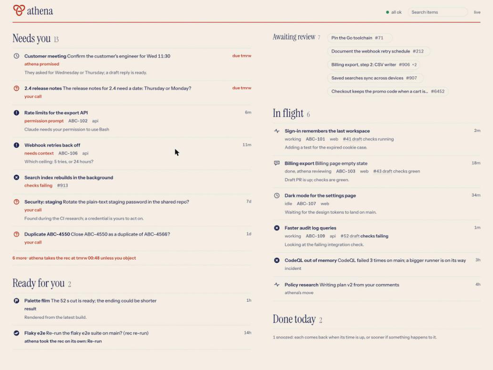

<picture>
  <source media="(prefers-color-scheme: dark)" srcset="assets/logo-lockup-dark.svg">
  
</picture>

A chief of staff for Claude Code. Hand it tickets; it runs the workers and brings you only what needs you.


## Install

You need a Mac with the Rex app, [Claude Code](https://claude.com/claude-code) and
[gh](https://cli.github.com) signed in.

```sh
git clone https://github.com/Delitefully/athena.git
cd athena
bin/athena install --services
```

The installer checks what it needs first and says what is missing. Then open athena:

```sh
athena hq
```

and tell it what to start: "start abc-101 and abc-102".

`athena update` brings each new release and keeps it only if it runs well. `athena install --uninstall` removes athena
and keeps your state. Coming from the herdr athena? Follow [docs/upgrade-from-herdr.md](docs/upgrade-from-herdr.md).

## How it works


athena runs in a Rex session of its own. For each ticket it writes a brief and starts a worker: a full Claude session in
its own git worktree, as a window in that repo's Rex session. You can open any window and type to a worker at any time.

It watches every worker and pull request, lets routine progress go by, and steps in when a worker is stuck, a check
fails or a review comes back. When a decision is yours, it asks you, once, and passes your answer on.


The dashboard (`athena dash open`) shows what needs you, what is ready for you, what awaits review and what is in
flight, and you can answer from it. A menu bar knot shows the same at a glance.



When a pull request is reviewed and green, you merge it, or tell athena to.
