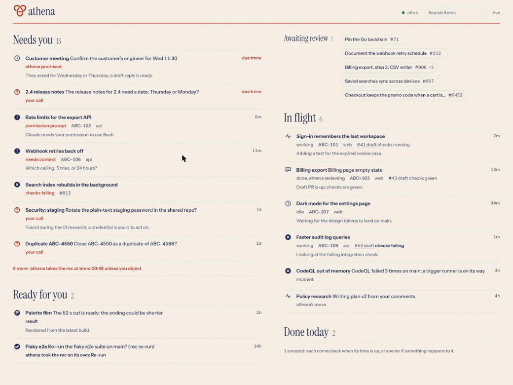

<picture>
  <source media="(prefers-color-scheme: dark)" srcset="assets/logo-lockup-dark.svg">
  
</picture>

A chief of staff for Claude Code in [herdr](https://herdr.dev). One Claude session named athena, in a herdr space of the same name, takes Linear tickets, launches a visible worker Claude for each in its own git worktree and herdr space, shows the workers as columns beside itself, and supervises them to merge-ready PRs. The human can type into any worker at any time.

## How it works


athena sits in its own space with the workers as columns beside it. It launches each ticket with a launch card, and when a worker gets stuck or finishes, a watch line appears and athena acts on it. When a worker needs a decision, athena asks you in its own pane and passes your answer on. Each worker is a full Claude session, so you can also type into its column directly.


A ticket becomes a brief and a worker in its own worktree. The worker builds, tests, pushes and opens a draft PR. athena checks CI, has a fresh reviewer read the diff, and sends findings back until the PR is ready. Then it asks you: you merge, or tell athena to.


`athena watch` prints one line per change, and athena reacts to the ones that matter: it asks you about a blocked worker, sends a failed check back to its worker, starts a review on DONE, and asks a repo's workers to rebase when its main moves. Routine progress stays quiet.

### The watch mod

In the HQ session, `athena watch` is run by a Claude Code mod that ships in this plugin (`hooks/watch-mod/`), not by Monitor tool calls, so routine changes never reach HQ's chat. The mod is active only where `ATHENA_ROLE=hq` (which `athena hq` sets); workers and every other session load it and see no change.

- It runs `athena watch --tagged` for the whole session and restarts it if it exits (5 s, backing off to a minute). There is no 30-minute expiry to re-arm.
- Each line is marked actionable or routine by `watch.classify`. Actionable lines wake HQ with one short prompt, a stamped header and one event per line, such as `athena watch 22:19:` then `abc-101 report DONE`: a report (DONE, DONE_WITH_CONCERNS, BLOCKED, NEEDS_CONTEXT), a worker turning blocked or exiting, a PR opened, merged or closed, failing checks, CHANGES_REQUESTED or APPROVED, new review comments, `main moved`, a stacked PR merged or newly CONFLICTING, an unexpected `gone from the ledger`, a worker that failed to start, and watch errors. Lines that arrive within a few seconds, or while HQ is running a turn, go out together once HQ is idle. The same line is told once in ten minutes unless the worker (or stacked PR) changed in between: a routine line about it lets its events be told again, so a check that fails, goes pending after a fix and fails again wakes HQ twice, while a repeat with no change between wakes it once. What was told is remembered across a mod reload and an HQ restart.
- Because HQ reads a wake as the person's own words, every line is rebuilt from an allowlist before it goes out: worker names as the ledger spells them (`^[a-z0-9][a-z0-9_-]{0,31}$`), fixed state, report, check and review words, PR numbers as `#n`, counts as integers. Free text (a `goal not sent` reason, an exception, a branch name, a PR URL's owner and repository) is cut to its allowlisted part, and a line it cannot rebuild goes out as `a watch line not shown here (athena status)`. Each regex is anchored.
- The band above the prompt draws the last wake as athena's own row, `∞ athena 22:19` then one event per line, until the human next types a prompt.
- The prompt is submitted `asUser`, so the transcript row shows just the prompt, under Claude Code's `› Prompt from the athena plugin` label, without the frame and the "This is how Claude Code surfaces a prompt a plugin submits…" sentence that a framed plugin prompt carries. Claude Code 2.1.296 raises no `ui.render` for a plugin's prompt row, so the mod cannot redraw it yet; its `UserMessage` hook draws a compact `∞ athena 22:19 <event>` row once a build does.
- Routine lines (working and idle flips, pending or green checks, `done->idle`, the `watching:` line) only update athena's status band above HQ's prompt, such as `∞ athena abc-9 blocked · #42 #43 #45 need you · pr47 working · ✓ abc-101, abc-102 done`: athena's mark in madder, then what needs the human in the theme's warning colour (blocked, NEEDS_CONTEXT and exited workers, then the PRs whose move is the human's), the active workers by state, and the done ones in the success colour. Narrower, the done ones fold to a count first (`✓ 2 done`), then the active ones, the PRs and the needs. The PRs are those whose dashboard row is in Needs you, each once: no reviewer requested where a review is required, approved (or needing no review) and waiting on the human's merge or go, changes requested or checks failing with no live worker on it, and a teammate's PR that asks the human for a review. A PR awaiting a teammate's review, in a merge queue or with auto-merge on is not counted, nor one whose worker is blocked (the worker is) or still working, and `needs-you.md` adds none. While `athena dash` runs, a dim `open dash →` ends the line, a masked link to the dashboard's URL as `athena dash show` reads it; it is the first thing to go as the line narrows, before any name or `#n` folds. The model never reads the band.
- Links: every `#n` the mod draws (the band, its wake row, a worker's completion block) is a masked link to `https://github.com/<owner>/<repo>/pull/<n>`, the repo taken from the ledger (a live worker's or a retired worker's origin remote, the stack's repo in `stack.json`, or the repo athena searched for review requests), never from a URL a worker, GitHub or a PR wrote; a PR with no known repo, one two repos share, or one only `needs-you.md` names draws as plain `#n`. Links are drawing only: the wake prompt stays plain text. Claude Code draws OSC 8 links only for terminals it knows, and herdr is not one though it renders them, so `athena hq` sets `FORCE_HYPERLINK=1` in HQ's settings; where the mod reads that the terminal gets no masked links (a worker in herdr, say), it draws plain text instead of the engine's raw-URL fallback.
- In a worker (`ATHENA_WORKER` set), the `ATHENA-REPORT` line its final message ends with draws as a completion block: athena's mark and the status in its colour (Done green, Done with concerns yellow, Blocked red, Needs context orange), the PR as `#n` (a masked link into the worker's own repo, from its origin remote, where the terminal draws one), the head, the verify line, the decisions and the concerns (yellow). Drawing only: the stored message, the status hook's parsing and what athena reads are unchanged, and a line that does not parse is drawn as is.
- Monitor rows in HQ's transcript (from before the mod, or from the fallback) are drawn as nothing, in HQ only: the call, its result, and its `Monitor event:`, stream-ended and expiry notifications. The model still reads them; ctrl+o still shows the notifications.
- Stacked PRs: `athena stack set <owner/repo> <pr> ...` lists a chain in `stack.json`; `athena watch` follows each PR's state, base and mergeability every two minutes.

**Fallback.** If the mod is not loaded (Claude Code older than 2.1.286, mods turned off, or the plugin not reloaded since an update; `pgrep -fl 'athena watch --tagged'` shows nothing), HQ arms Monitor with `athena watch` itself and re-arms it every 30 minutes, as the `athena` skill says.

To try the mod without real workers, start a throwaway session with `ATHENA_ROLE=hq` and `ATHENA_WATCH_CMD=tests/lab/fake-watch` in its `--settings` env, and append watch lines to its `FAKE_WATCH_LINES` file.

## Requirements

- macOS or Linux, with Python 3.9 or later as `/usr/bin/python3` (athena is standard-library Python).
- [herdr](https://herdr.dev) 0.9.1 or later. `athena init` offers to install it if it is missing.
- [Claude Code](https://claude.com/claude-code) as `claude`, with this plugin installed (below). The watch mod needs Claude Code 2.1.286 or later; older versions fall back to Monitor.
- [gh](https://cli.github.com), signed in (`gh auth login`), and a git identity (`git config --global user.name` and `user.email`): workers push branches and open PRs.
- Go, only for the dashboard (built on first use).
- Optional: the herdr-agent-quota herdr plugin, for the 5-hour quota gate. Without it the gate is skipped.

## Install

```sh
git clone https://github.com/Delitefully/athena.git
mkdir -p ~/.local/bin && ln -sf "$PWD/athena/bin/athena" ~/.local/bin/athena   # ~/.local/bin on your PATH
claude plugin marketplace add "$PWD/athena"
claude plugin install athena@athena
athena init
```

`athena init` checks what athena needs and prints each check as ✓ or ✗ with its fix: herdr (and its version), `claude` and the athena plugin, `gh` signed in, a git identity, and the optional herdr plugins. If herdr is missing it shows the install command from herdr.dev (`curl -fsSL https://herdr.dev/install.sh | sh`, or `brew install herdr`) and runs it only if you say yes. Then it asks for:

- your **projects folder**, where your repos live and HQ starts (default: the folder holding the repo you run it from, else `~/code`);
- the **worktree root**, one git worktree per worker (default `<projects>/.worktrees`);
- the **repos you merge yourself** (athena prepares them and stops), and the repos where **a push after approval needs a new approval**;
- the workers' default **model and effort** (opus/high);
- the herdr-agent-quota **state file**, if you have that plugin.

and writes them to `config.json` in athena's state dir. For scripts: `athena init --yes --projects ~/code [--worktrees DIR] [--human-merge a,b] [--reapproval a] [--model M] [--effort E] [--quota-file F] [--install-herdr]` asks nothing (a flag, else the current config, else the default) and installs herdr only with `--install-herdr`. Run it again any time to change a value.

## Quickstart

```sh
athena
```

From any terminal, `athena` (or `athena hq`) starts a herdr server if none runs, creates or focuses the `athena` space with the chief of staff's Claude in it, then attaches your terminal to herdr with that space in front (it execs into `herdr`). Detach with `ctrl+b q`; HQ and the workers keep running, and `athena` brings you back. Inside herdr, `athena hq` opens or focuses the space as before. The first `athena` with no config runs `athena init` first.

Then tell HQ what to start: "start abc-101 and abc-102".

## Use

- `prefix+shift+c` (or `athena hq`): open or focus the hq space. The chief of staff starts with its brief (`hq.md`) and the `athena` skill.
- Tell it what to start: "start abc-101 and abc-102". It reads Linear, writes a brief, shows a launch card, and runs `athena spawn`.
- `prefix+shift+h` (or `athena hq restart`): update Claude Code and its plugins, then restart HQ's Claude in the same pane on the same conversation; it runs its start routine by itself. HQ can run it about itself. Workers and the dashboard keep running.
- `prefix+shift+b` (or `athena board toggle`): show or hide the worker columns beside hq.
- `athena dash open`: the dashboard in your browser.

## Dashboard

<picture>
  <source media="(prefers-color-scheme: dark)" srcset="assets/dashboard-dark.png">
  
</picture>

While HQ is open, `athena dash` serves one page on `http://127.0.0.1:2843/`: what needs you, what is in progress with its PR checks, and what was done in the last two weeks, each linked to its ticket and PR. Every PR athena follows (a live worker's, a stacked one from `stack.json`, a retired worker's while still open) has one row, and its label says whose move it is, as `who · what`:

| Whose move | Label | Section |
|---|---|---|
| a teammate | `awaiting review · <names>` | In progress |
| nobody yet | `no reviewer requested` (a review is required, and nobody is asked) | Needs you |
| the human, merge, no review rule | `your go to merge`, `yours to merge` (`human_merge_repos`); `in merge queue`, `auto-merge on` go to In progress. Its branch requires no review, so a green PR waits on the merge alone, once its worker is done | Needs you |
| the human, merge | `approved · yours to merge` (`human_merge_repos`), `approved · your go to merge` (athena merges once you say go) | Needs you |
| nobody | `approved · in merge queue`, `approved · auto-merge on` | In progress |
| the worker | `changes requested · worker fixing`; with no live worker, `changes requested` in Needs you | In progress |
| the human, review | `your review requested` (a teammate's PR naming you, from one `gh search prs --review-requested=@me` per repo athena knows, every two minutes, at most 10) | Needs you |
| CI | `checks failing`; in Needs you when no worker is live | In progress |

A worker's own state comes first: blocked, a permission prompt, needs context and a startup prompt need you; a worker still working, or a draft with athena reviewing, stays in progress. PR status is derived from GitHub, so athena no longer writes PR approval asks into `needs-you.md`: that file is for decisions. A line there that links a PR with a row folds into that row as a muted second line, without the URL of that PR (the row links it); any other is a row of its own, `athena asks` when it has a `?` outside a URL and `note` otherwise. A bare PR URL in a note shows as `owner/repo#n`. It reads athena's state files only (`athena watch` fetches the PRs), makes no network calls, and updates by itself within a second of a change. `athena hq` starts it, and closing HQ's space stops it. It is a small Go program in `dash/`, built on first use (Go required); the plan and its failure modes are in [docs/dashboard.md](docs/dashboard.md).

## Commands

| Command | What it does |
|---|---|
| `athena preflight <repo>` | Main checkout clean, on main, fast-forwarded |
| `athena spawn --repo --branch --name --brief --goal ...` | Worktree space, worker Claude (`--name`, `worker.md`, per-worker settings), then its `/goal` |
| `athena status [--json] [--pr]` | Merged status: ATHENA-REPORT, hook state, git, PR, herdr |
| `athena board on\|off\|toggle\|sync\|show` | Attach columns beside hq; a watcher keeps them in step with width and workers |
| `athena dash on\|off\|show\|open` | The dashboard on 127.0.0.1; `show` prints its URL and pid |
| `athena watch [--tagged]` | One line per change; also saves its snapshot to `watch.json` for the dashboard. The watch mod runs it `--tagged` (JSON lines: each change marked wake or not, and the status band's board); plain output is for the Monitor fallback |
| `athena stack [set <owner/repo> <pr>... \| clear <owner/repo>]` | The stacked-PR chains `athena watch` follows (`stack.json`) |
| `athena pr <name>` | PR summary |
| `athena nudge <name> <text>` | Type a slash command into a worker |
| `athena resume <name>` | Send the goal of a worker that stopped at a startup prompt, once the human has answered it (`athena watch` does this on its own) |
| `athena retire <name> [--force] [--keep-worktree]` | Back up, refuse to lose work, stop, remove the worktree space |
| `athena` | Outside herdr, from a terminal: start herdr if needed, open HQ, attach. Inside herdr: same as `athena hq` |
| `athena init [--yes ...]` | Check herdr, claude and the plugin, gh, git; ask for folders, merge rules, model; write `config.json` |
| `athena config [show\|path]` | The effective config and where each value comes from |
| `athena hq [--no-attach]` | Create or focus hq; from a terminal outside herdr, also start herdr and attach |
| `athena hq restart [--no-update]` | Detached: `claude update`, the marketplaces and the user-scope plugin updates (concurrently), `/exit` HQ's Claude (confirming the background-work dialog), `--resume` its conversation in the same pane, prompt its start routine. A failed resume starts a fresh HQ and says so; log in `logs/hq-restart.log` |

## Pieces

- `athena_lib/`: stdlib Python 3.9+. State in `~/.local/state/athena/` (`ledger.jsonl`, `workers/`, `briefs/`, `settings/`, `claims/`, `board.json`, `hq.json`, `stack.json`, and for the dashboard `watch.json`, `history.jsonl`, `needs-you.md`).
- `dash/`: the dashboard server, Go standard library only, with the Instrument fonts (OFL) embedded.
- `hooks/`: Claude Code plugin hooks that write `workers/<name>.json` (a no-op outside athena workers), and `hooks/watch-mod/`, the watch mod (a no-op outside HQ).
- `hq.md`, `worker.md`, `skills/athena/SKILL.md`: the prompts.
- `repos/example.setup`: an example per-repo worktree setup. Your own go in `repos/<repo>.setup` next to `config.json` (looked up there first); `athena spawn` runs the one named after the repo's folder in each new worktree.
- The herdr auto-claude plugin skips spaces that `athena` claims (`~/.local/state/athena/claims/`).

## Test

`make test` (unit tests with a fake herdr, `go test` for the dashboard, and `claude plugin validate` and `claude plugin test` for the watch mod when `claude` is installed). `tests/lab/` runs real workers against an isolated herdr server.

## Configuration

`athena init` writes `config.json` in the state dir (`~/.local/state/athena/` unless `ATHENA_STATE_DIR` moves it); `athena config show` prints each value and where it came from, `athena config path` the file. Edit it by hand or rerun `athena init`.

```json
{
  "version": 1,
  "projects_dir": "~/code",
  "worktree_root": "~/code/.worktrees",
  "human_merge_repos": ["web"],
  "reapproval_repos": [],
  "model": "opus",
  "effort": "high",
  "quota_file": null
}
```

- `human_merge_repos`: repos (by folder name) the human merges; HQ prepares them and stops. `reapproval_repos`: repos where a push after approval needs a new approval; their workers get `ATHENA_REAPPROVAL=1` and say so.
- `quota_file`: the herdr-agent-quota plugin's `claude-statusline.json`. With none, `athena spawn` does not gate on the 5-hour quota.
- An environment variable overrides its key: `ATHENA_HQ_CWD` (`projects_dir`), `ATHENA_WORKTREE_ROOT`, `ATHENA_MODEL`, `ATHENA_EFFORT`, `ATHENA_QUOTA_FILE`. `ATHENA_CONFIG` points at another file.
- Upgrading from a version without `config.json`: the first athena command writes that version's values down (one line on stderr, no prompt). Nothing changes. Per-repo setup scripts are not moved: put yours in `repos/` next to `config.json`.

## Environment

`ATHENA_STATE_DIR`, `ATHENA_WORKTREE_ROOT` (overrides config `worktree_root`), `ATHENA_HERDR`, `ATHENA_HQ` (default `athena`), `ATHENA_MIN_COL` (70), `ATHENA_MAX_WORKERS` (4, hard cap 6), `ATHENA_PLUGIN_DIR` (load the plugin from a directory in workers), `ATHENA_HQ_PANE`, `ATHENA_DASH_PORT` (2843), `ATHENA_LINEAR_WORKSPACE` (the Linear workspace in ticket links; or `linear_workspace` in `~/.local/state/athena/dash.json`; neither leaves ticket ids unlinked).

## Troubleshooting

- **`athena: no config yet: run athena init first`**: `athena hq` ran without a terminal (a key binding, a script) before any config existed. Run `athena init` once in a terminal.
- **`✗ herdr: not found` after installing it**: the installer put it in a folder your shell does not search yet. Open a new terminal, or add that folder (often `~/.local/bin`) to `PATH`.
- **`herdr server did not start`**: read `logs/herdr-server.log` in the state dir; `herdr status server` shows which socket athena expects. A server from an older herdr: `herdr server stop`, then `athena`.
- **`athena` prints JSON instead of attaching**: it attaches only from a terminal outside herdr (no `HERDR_ENV`, stdin and stdout a tty). Inside herdr, `athena hq` focuses the space instead.
- **Workers in the wrong folder, or the hooks not seeing a worker**: `athena config show` lists the worktree root they use; an `ATHENA_WORKTREE_ROOT` in your shell wins over the file. Keep herdr's `[worktrees] directory` the same.
- **`athena spawn` never gates on quota**: there is no `quota_file`, or it is older than 30 minutes. Install herdr-agent-quota and rerun `athena init`.
- **`config.json is not valid JSON`**: fix the file, or move it away and rerun `athena init`.

## Update after editing

The `athena` CLI and the prompt files (`hq.md`, `worker.md`) run from this repository. The hooks, the watch mod and the `athena` skill run from the plugin: bump `version` in `.claude-plugin/plugin.json`, then `claude plugin marketplace update athena && claude plugin update athena@athena`, and restart the sessions that should pick it up (or `/reload-plugins` in them; the plugin is read from its folder when its marketplace is that folder).
