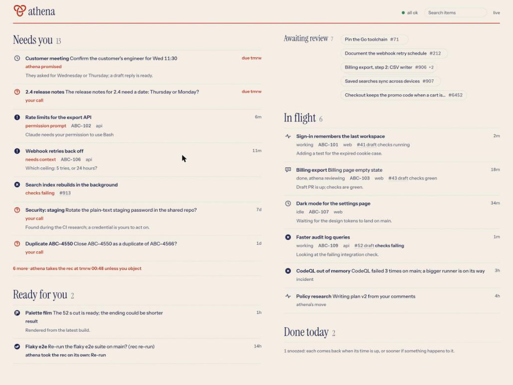

<picture>
  <source media="(prefers-color-scheme: dark)" srcset="assets/logo-lockup-dark.svg">
  
</picture>

A chief of staff for Claude Code, on Rex. You hand athena Linear tickets. For each one it launches a visible worker
Claude in its own git worktree, as a window in that repo's Rex session, and supervises the workers to merge-ready PRs.
It asks you only when a decision is yours, and you can type into any worker at any time.


## Requirements

- macOS, with Python 3.9 or later as `/usr/bin/python3` and Xcode's command line tools (git, and Swift for the menu bar app).
- The Rex app.
- [Claude Code](https://claude.com/claude-code) as `claude`.
- [gh](https://cli.github.com), signed in (`gh auth login`), and a git identity: workers push branches and open PRs.

## Install

```sh
git clone -b rex-athena https://github.com/Delitefully/athena.git athena-rex
cd athena-rex
./bin/athena-rex install --dry-run    # checks Python, git, Rex, Claude and gh, and says what it would write
./bin/athena-rex install --services   # installs athena-rex in ~/.local/bin and starts its background jobs at login
```

`athena-rex install --check` looks over what is installed, `--rollback` goes back one release, and `--uninstall`
removes it all and keeps your state.

## Quickstart

```sh
athena-rex hq   # opens athena's own Rex session, with the dashboard and the board
```

Then tell athena what to start: "start abc-101 and abc-102".

## How it looks in Rex


athena runs in a Rex session of its own, named `athena`. Each repo gets one Rex session, and each worker is a window in
it, named for its ticket, so Rex's sidebar groups your workers by repo. Retiring a worker closes its window, and the
repo's session once it is empty. Rex runs the sessions: quitting athena stops none of them.

## Using it day to day

- **Start work:** tell athena the tickets. It reads Linear, writes a brief, shows a launch card and starts a worker.
- **Answer questions:** when a worker needs a decision, athena asks you in its own session and passes your answer on.
- **Step in:** each worker is a full Claude session; open its window and type whenever you like.
- **Review and merge:** athena checks CI and has a fresh reviewer read each PR. Then you merge, or tell athena to.
- **`athena-rex status`:** what every worker is doing.
- **`athena-rex hq rotate`:** replace a long HQ conversation with a fresh one that starts from a handoff, instead of compacting it.
- **Fewer questions:** athena does the routine steps in [`never-ask.md`](plugin/skills/athena-rex/never-ask.md) itself
  and always asks about the rest. Add your own lines to `never-ask.md` in the state dir.

## Built from parts

athena-rex is a small core and a set of parts. Each part owns its own commands, and can add a line to doctor, a
background job or lines to the watch. Leave one out of `rex.caps` in `config.json` and the rest work without it. The
ones you meet first:

- **The watch** (`athena-rex watch`) follows every worker and PR, lets routine progress go by, and wakes HQ only for
  what it must act on.

  

- **Doctor** (`athena-rex doctor`) prints one line per part athena needs and whether it runs. As a background job it
  runs every minute and repairs what it safely can.
- **The dashboard** (`athena-rex dash open`, at `http://127.0.0.1:2843/`) shows what needs you, what is ready for you,
  what awaits review, what is in flight and what was done today. Every request you give HQ becomes an item there,
  and you can answer items on the page.

  

- **The menu bar app** shows each background job, the fleet and each module, with Doctor, Open dashboard, Open HQ, and
  Quit athena or Start athena.
- **The board** (`athena-rex board open`) is a live, read-only panel beside HQ with each worker's state.
- **Services** (`athena-rex services install`) runs every part's background jobs as launchd agents, so they restart
  after a crash and come back after a reboot.

The rest follow PRs, stacks and CI on main, ring for Slack DMs, track usage limits, and keep worktrees and scratch
space tidy: `athena-rex --help` lists them all.

### Optional modules

A module is a part that stays off until you load it, with its own entry in the menu bar. One ships with athena-rex:

- **clamshell:** whether this Mac stays awake with its lid closed while HQ runs on good AC power, and why.

```sh
athena-rex modules list                 # the modules you have loaded, and whether each is on
athena-rex modules load clamshell       # turns it on and keeps it on
athena-rex modules action clamshell toggle
athena-rex modules unload clamshell     # turns it off and takes it out of the list
```

Your own modules live in `~/.config/athena-rex/modules/`, outside this repo; [Writing a module](docs/modules.md)
says how.

## Learn more

- [Writing a module](docs/modules.md): the hooks a module can use, and how it loads.
- [Worktrees and scratch spaces](docs/workspaces.md): what owns each space, and how cleanup keeps your work.
- [HQ's procedures](plugin/skills/athena-rex/SKILL.md): how athena starts, briefs, watches and reviews workers.
- [Architecture](ARCHITECTURE.md): the code layout and the choices it was built on.
