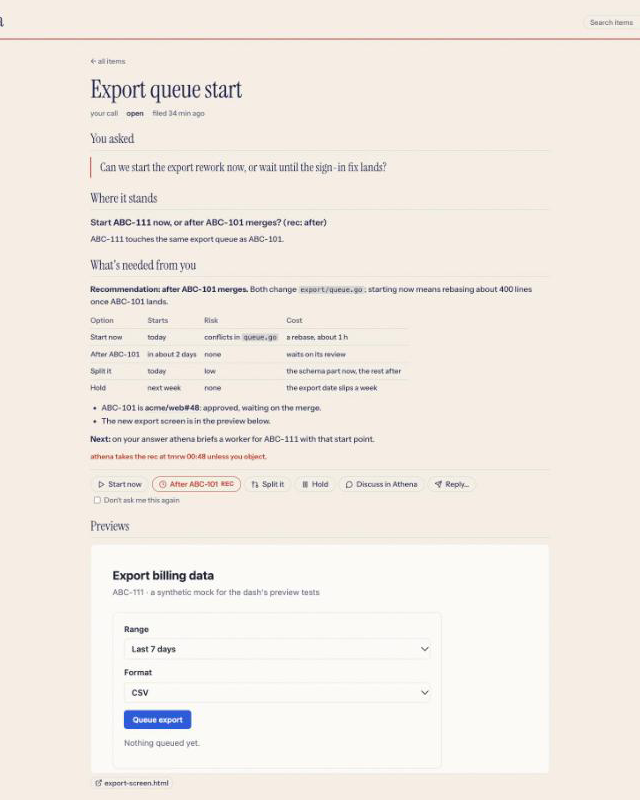
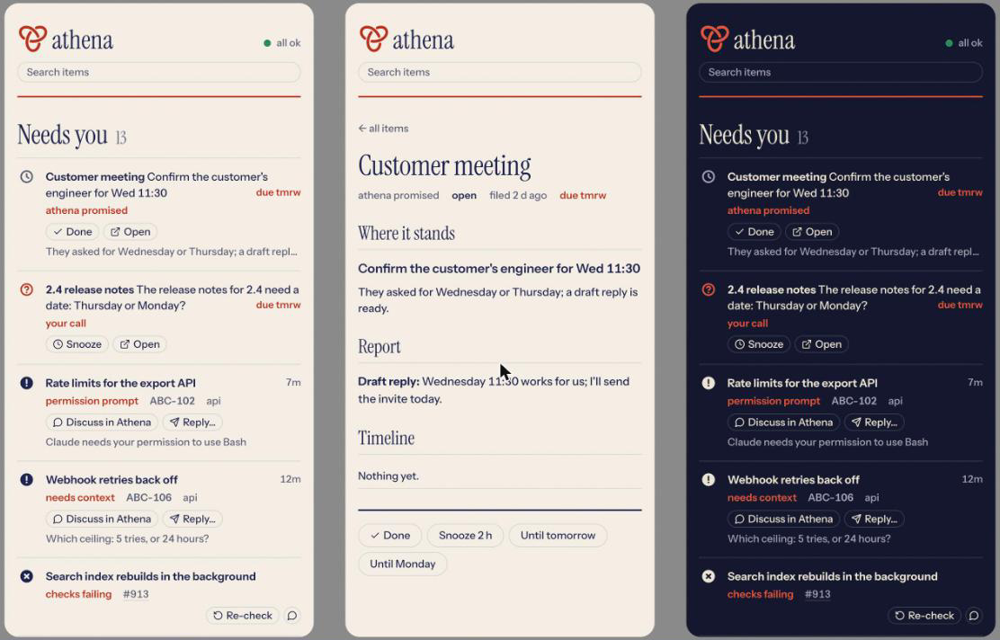

# Dashboard

`athena dash` serves one page on `http://127.0.0.1:2843/`, a dash you can live in: what needs you, what is ready for you to read, what is in flight, and what was done today, each row led by its name, with a full view per item ([Items](items.md)). It reads athena's state files, writes only what the human does on it, and updates by itself when they change.

## What the page shows

<picture>
  <source media="(prefers-color-scheme: dark)" srcset="../assets/dashboard-dark.png">
  
</picture>

 

The page has two columns: yours (**Needs you**, **Ready for you**) and everyone else's move (**Awaiting review**, **In flight**, **Done today**, folded). A row leads with its name (an item's 2 to 4 words, a worker's title), then the call or where it stands, with its age or due date on the right (`2h`, `7d`, `due tmrw`, `overdue 3h`); the label, ticket, repo and PR are in the line under it. The header's dot is athena doctor's last check, from `health.json`: green `all ok`, red with what is wrong, or grey `health unknown` while there is no check or the last is over 3 minutes old (never green then). Every PR athena follows (a live worker's, a stacked one from `stack.json`, a retired worker's while still open) has one row, and its label says whose move it is, as `who · what`:

| Whose move | Label | Section |
|---|---|---|
| a teammate | `awaiting review · <names>` | Awaiting review: a row of compact pills above the columns, only when there are any. A PR stacked on one stacks behind its pill and fans out on hover. Hover a pill for **Re-check and fix** (HQ inspects the PR and gets it ready again through a worker, never merging) or **Dismiss** (hidden until its head or review state changes) |
| nobody yet | `no reviewer requested` (a review is required, and nobody is asked; a live worker's PR only once HQ's review passed at its head) | Needs you |
| the human, merge, no review rule | `your go to merge`, `yours to merge` (`human_merge_repos`); `in merge queue`, `auto-merge on` go to In flight. Its branch requires no review, so a green PR waits on the merge alone, once its worker is done | Needs you |
| the human, merge | `approved · yours to merge` (`human_merge_repos`), `approved · your go to merge` (athena merges once you say go) | Needs you |
| athena | `in review · athena`: a live worker's PR that would be the human's to merge (approved, or no review rule, and green) or would need a reviewer requested, but whose worker's verdict from `athena review` is not a pass at the PR's current head (none yet, `start`, or a verdict at an older head). Only once its worker reported DONE; before that its row shows the worker's state | In flight |
| the worker, after athena's review | `review findings · worker fixing`: athena's review failed at the PR's current head | In flight |
| nobody | `approved · in merge queue`, `approved · auto-merge on` | In flight |
| the worker | `changes requested · worker fixing`; with no live worker, `changes requested` in Needs you | In flight |
| the human, review | `your review requested` (a teammate's non-draft PR naming you, not just your team, from one `gh search prs user-review-requested:@me draft:false` per repo athena knows, every two minutes, at most 10) | Needs you |
| CI | `checks failing`; in Needs you when no worker is live | In flight |
| CI, before a merge | `checks running` while checks run, `checks starting` while none have registered yet: approved (or needing no review) | In flight |

A worker's own state comes first: blocked, a permission prompt, needs context and a startup prompt need you; a worker still working, or a draft with athena reviewing, stays in flight. A PR is the human's to merge (`approved · …`, `your go to merge`, `yours to merge`) only once its checks are green (or the repo runs no CI: no `.github/workflows` on its default branch, asked once a day per repo) and, with a live worker, once that worker reported DONE and HQ recorded a passing review at the PR's current head (`athena review <w> pass`); until the worker reported DONE its row shows the worker's state, and from then until the pass it is `in review · athena`, In flight. A new commit voids the verdict, so the PR is in review again. A PR with no live worker (stacked, or a retired worker's) has no athena review to wait for. PR status is derived from GitHub, so athena asks no PR approvals. Items (`needs-you.json`) are placed by whose move they are: a decision of the human's in Needs you, a result or a default athena applied on its own in Ready for you, anything else in flight, a resolved one in Done today; an item is never folded under a PR's row, and one with a live worker names that worker's row instead of a row of its own. Hovering a row shows its quick actions: an item's one-click calls (Take rec, Done, Snooze, Open), a live worker's Discuss and Reply, and a PR row's buttons for its state (Request review, Re-check, Open PR, Merge where athena merges; see below). An answer collapses its row at once and offers Undo for 5 seconds; it goes to `actions.jsonl`, `athena watch` rings HQ with `dash-queue <seq>` once it settles, and HQ reads it with `athena ask queue`, so rapid triage queues and never interrupts an HQ turn. Done and Snooze are the dash's own and never reach HQ. It makes no network calls and updates by itself within a second of a change. `athena hq` starts it, and closing HQ's space stops it. It is a small Go program in `dash/`, built on first use (Go 1.22 or later required; offline, from the vendored modules in `dash/vendor/` with `GOTOOLCHAIN=local`); the plan and its failure modes follow below.

## Plan

The plan below is after a /refute pass; the objections it took and rejected are in the last section.

### Language: Go

Go: `net/http`, `html/template`, `embed`, and one dependency, goldmark v1.8.6 (MIT), for an ask's Markdown body, vendored in `dash/vendor/` so the first-use build needs no network. One static binary with the page, the CSS and the fonts inside it, and `go test` for the tests. Rust would need crates for HTTP and templating; Go needs none.

The binary is built on first use: `athena dash on` runs `go build` into `~/.local/state/athena/bin/athena-dash-<hash>`, where the hash covers the sources in `dash/`, so an edit rebuilds and an unchanged tree starts at once. The repository keeps no binary.

### Files read

All under `ATHENA_STATE_DIR` (`~/.local/state/athena/`):

| File | Writer | Gives |
|---|---|---|
| `ledger.jsonl` | athena commands | every worker: name, repo, branch, ticket, title, spawned, retired, `goal_pending` |
| `workers/<name>.json` | the worker's hooks | state (working, idle, blocked, done, exited), summary, `report` and `last_report` (status, pr, head, concerns) |
| `watch.json` (new) | `athena watch` | the last snapshot: each live worker's merged state and PR (url, number, state, draft, checks, review, requested reviewers, latest reviews, auto-merge, merge queue, and whose move it is), every other PR athena follows (`prs`: stacked, or a retired worker's still open), and the teammates' PRs asking the human for a review (`review_requests`) |
| `history.jsonl` (new) | `athena retire` | one line per retired worker with its PR as last known, so a merge is still known after retire |
| `needs-you.json` | `athena item`; this server for Done and Snooze | the items ([Items](items.md)): `{next, items: [{id, name, kind, next, text, why, body, pr, options, rec, auto, stakes, due, words, requests, workers, links, previews, created, updated, log, resolved, resolved_note, resolved_by, snooze, applied}]}`, mode 0600: `text` is the title (one sentence, at most 120 characters), `body` up to 8000 characters of Markdown, at most 2 options, 4 with a body. This server rewrites one item's `resolved`, `snooze`, `log` and `updated` under `ask.lock`, keeping every other field. `previews/<id>/` holds an item's previews. PR status is derived, never asked here. An old `needs-you.md` is imported once and renamed `.migrated` |
| `items-archive.jsonl` | `athena item` | items resolved over a week ago, one a line: their full view and search still find them |
| `health.json` | `athena doctor` | its last check: `{ts, ok, problems: [{check, detail, since}], checks}`; the header's dot |
| `requests.jsonl` | HQ's prompt hook | the request log (`athena item requests`): the time of the last line is the human's last activity, for defaults that apply sooner once they are away |
| `actions.jsonl` | this server, `athena item done` | the human's answers from the page, append-only: `{seq, ts, item, option\|text\|discuss, status: queued}` (a Merge also has its `head`; `rule: true` rides on an answer given with "Don't ask me this again"; `auto: true` marks a default this server applied on its own), then `{seq, ts, status: done\|cancelled}` |
| `dismissed-prs.json` | this server | PRs the human dismissed from the Awaiting review row: `{prs: {"owner/repo#n": {head, review, ts}}}`. A PR shows again once its head commit or its whose-move label changes; entries older than 30 days are dropped on the next write. Never read by athena |
| `stack.json` | `athena stack` | the stacked-PR chains athena watches, read here for the order a stack shows in |
| `dash.json` (optional) | the human | local settings: `{"linear_workspace": "..."}` for ticket links |

The ledger and the worker files alone give every worker row: the ledger keeps retired workers with their ticket, title and retire time, and a worker's file outlives it with its last report, which carries the PR url. The new files only enrich: `watch.json` adds checks, review and draft for live PRs, and `history.jsonl` adds whether a retired worker's PR merged. Today's state has none of them, and the page still works on it.

`board.json`, `hq.json`, `standing-orders.md`, `notes.md`, `handoff.md` and `threads.md` are not read: the page has no use for layout, and notes and handoffs are athena's own.

### Python additions

- `watch.py`: after each tick, write the snapshot to `watch.json` (temp file, then rename), with a `ts`. Each live worker's `gh pr view` also reads its review requests, latest reviews, auto-merge and merge-state; every two minutes one GraphQL call reads the stacked PRs and the retired workers' open ones together, and one `gh search prs user-review-requested:@me draft:false` per repo finds the open, non-draft PRs asking the human by name for a review (a request to one of the human's teams does not count). `pr.move` turns each PR into whose move it waits on.
- `retire.py`: before the `retire` ledger event, append to `history.jsonl` the worker's ticket, title, repo, branch, report status and PR. The PR comes from one `gh pr view` (`pr.summary`), else from `watch.json`, else from the report's `pr` url. HQ retires right after it merges, while `athena watch` polls every 20 s, so the snapshot alone would usually still say open.
- `dash.py` and `athena dash on|off|show|open`, below.
- `asks.py` and `athena item` (alias `athena ask`) `add|edit|body|done|snooze|show|queue|migrate`: needs-you.json written atomically (temp file, then rename), and `actions.jsonl` read, marked done and compacted under `ask.lock`, which the server's appends and item writes hold too. `requestlog.py` and `athena item requests|check|ignore`: the request log.
- `watch.py`: between ticks it looks at `actions.jsonl` once a second (one stat while nothing changed) and prints `dash-queue <seq>` once answers settle: the doorbell HQ answers with `athena ask queue`.
- `skills/athena/SKILL.md` section 6: HQ files every request as a named item, edits it in place, resolves it when the human took the last step, and acts on the queue. PR approval items are not added.

### Data model

The server folds the files into one view, every second when something changed:

- **Needs you**
  - a live worker whose hook state is `blocked` (a permission prompt, or a `BLOCKED` or `NEEDS_CONTEXT` report; the label says which, and the report's first concern is the detail);
  - a live worker with `goal_pending` (a startup prompt only the human may answer);
  - a PR whose move is the human's: no reviewer requested where a review is required, approved and yours to merge (or your go), green with no review rule on its branch (`your go to merge`); a live worker's PR, merge or no reviewer requested, only once HQ's review passed at its head (else `in review · athena` or `review findings · worker fixing`, In flight); a merge row only once checks are green, or the repo has no `.github/workflows` (asked once a day per repo); else `checks running` or `checks starting`, In flight, and a live worker reported DONE, changes requested or checks failing with no live worker, or a teammate's PR asking for your review;
  - each open item whose move is the human's (`next: you`, not a result): a decision, with Take rec when it has a recommended option and, when its default applies on its own, `athena takes the rec at 09:00 unless you object`; its `why` in the detail line; a bare PR URL shows as `owner/repo#n`. An item due within a day comes first, by due date; then blocked workers and failing checks, then the human's calls, oldest first, then PR rows. At most 7 rows show; the rest fold behind `n more`, which says when the first default among them applies. An item the human answered is hidden while the answer is queued, and shows again, saying so, after 10 minutes.
- **Ready for you**: each open result (an answer, a report) the human has not marked Done, an item whose default athena applied on its own (`athena took the rec on its own: <option>`, with Done and Undo), and a request or promise whose PR merged.
- **Awaiting review**, a row at the top of the right column, shown only when it has pills: each PR whose move is `awaiting review · <names>` is a compact pill (its title cut near 48 characters, the full title and the label in its tooltip, and its `#n` muted), the whole pill a link to the PR. A PR stacked on one (its base is that PR's head branch, from the PR or the ledger, or it comes later in a `stack.json` chain) stacks behind its pill, in chain order, when it would otherwise be an In flight row placed by its PR's state: a quiet stacked edge and a muted `+n` while collapsed, fanning out below on hover or focus, each with `waits on #<base>`. A PR that needs the human, or whose live worker's own state shows (working, blocked), keeps its row. A dismissed PR counts as off the row, so a PR stacked only through it has its own place again. An item about a PR on the row is a row of its own, as every item is.
- **In flight**: every other live worker, with its state, its last summary line, and its PR with checks and review (a worker an item names shows the item's name first and the worker's title after it); every open item whose move is athena's, a worker's, a reviewer's, a customer's, a colleague's or CI's; and every PR whose move is a merge queue's, auto-merge's, a worker's or CI's, labelled `who · what` (`checks running`). Each PR athena follows shows in one place: a live worker's row, a stacked one with no live owner, a retired worker's while still open, or a pill. A snoozed item is off the page until its time, or until it changes; a line under the column counts them.
- **Done today**, folded: items resolved and workers retired with a PR or a Linear ticket in the last 24 hours, newest first, at most 12, and live workers whose PR is merged. Older ones are found by the header's search (`/items?q=`), which reads open, resolved and archived items.

Links are built from ids: a ticket `ABC-101` links to `https://linear.app/<workspace>/issue/ABC-101`, where the workspace comes from `ATHENA_LINEAR_WORKSPACE`, else from `dash.json` in the state dir (`{"linear_workspace": "..."}`, read live like the other files and kept out of this public repository), else the id shows unlinked. A PR links to the url already in state.

### Update mechanism

- The server polls every second: it lists the state dir and `workers/` and compares each file's size and modification time with the last tick. Only a change triggers a read. A few `stat` calls a second keep idle CPU near zero, and polling needs no dependency and cannot miss an event the way a dropped fsnotify watch can.
- On a change it re-reads, re-renders the page's `<main>`, and if the HTML differs, pushes it to every open page over Server-Sent Events (`/events`). The page swaps `<main>` in place: a few lines of JS, no build step, no reload button.
- Every row has a stable id (its worker name or note). After a swap, only rows whose id was not there before enter, by a moving edge (a clip from left to right, `cubic-bezier(.16,1,.3,1)`, staggered 70 ms), and only when the reader allows motion. Times show as "4 min ago" and a small timer refreshes them every 30 s, without a server round trip.

### Lifecycle

- `athena dash on`: if the pid in `dash.pid` is alive and is our binary, print its URL and pid and stop (idempotent). Otherwise build if needed, start the binary in its own session with output to `logs/dash.log`, write `dash.pid`, and wait up to 5 s for `/healthz` to answer with that pid. A server for the same state dir that already answers on the port is adopted rather than started twice, also when a concurrent `on` wins the race while this one is starting.
- `athena dash show` prints the URL and pid, or `dash off`. `athena dash off` sends SIGTERM and waits for it to exit. `athena dash open` runs `on`, then opens the URL in the browser.
- It runs until stopped, no longer tied to HQ's process: `athena dash on`, `athena hq` and `athena doctor --fix` start it with `--hq-pid 0`, and `athena dash run` (what the dashboard service runs) execs it in the foreground the same way. `athena dash off` stops it; under `athena service` its job brings it back after a crash. The server still takes `--hq-pid <pid>` (it then checks that pid every 2 s and exits when it is gone), and `dash.start(hq=<pid>)` passes one, but nothing in athena does any more.
- The port is `2843` (`ATHENA_DASH_PORT` overrides). It binds `127.0.0.1` only, and answers only requests whose `Host` is `127.0.0.1:<port>` or `localhost:<port>`, so a web page cannot read it through DNS rebinding.

### Failure modes

| Failure | Behaviour |
|---|---|
| A state file is missing | That source is empty. A missing state dir shows an empty page with a quiet note. |
| A JSON file is half written or invalid | The server keeps that file's last good parse and shows a quiet note naming the file. Writers already replace files atomically, so this should be rare. |
| A ledger line is invalid (a partial last line) | That line is skipped, as `ledger.py` does. |
| The port is taken | The server exits with "port 2843 is in use"; `athena dash on` prints that and the `ATHENA_DASH_PORT` hint, and removes the pid file. |
| `go` is missing | `athena dash on` looks on `PATH`, then in `/opt/homebrew/bin` and `/usr/local/go/bin` (herdr's key bindings may run with a short `PATH`), then says so. `athena hq` carries on without the dashboard. |
| `watch.json` is stale (HQ not running `athena watch`) | PR checks and review show with "as of 12 min ago" once older than 2 minutes; the PR link still comes from the report. |
| HQ closes | The server exits within 2 s. Open pages show "dashboard stopped" and reconnect when it is back. |
| The server crashes | `athena dash show` reports it off (the pid is gone or is not ours); `athena hq` or `athena dash on` starts it again. |
| A panic or template error while rendering | The poll recovers and keeps the last good page on open tabs; the server keeps running. |

### Quick actions

Rows offer compact pills (22 px) that take the place of the row's label line on hover or focus: the pills share that line's grid cell, which is pill-high only on rows with pills, so no space is reserved and nothing moves, and a moving edge swaps them in, fading nothing (touch and narrow screens show them below the line, always). An item's row offers only one-click calls: **Take rec** (a decision with a recommended option, queued for HQ as that option), **Done** and **Snooze** (a result; Snooze alone on a decision), **Undo** and **Done** (a default athena applied), and **Open**, its full view. A live worker's row offers **Discuss in Athena** and **Reply…**. An answer is a `POST /api/action` (`{item, option}`, `{item, text}` up to 2000 characters, `{item, discuss: true}`, with `rule: true` beside an option or reply to a decision, or `{seq, undo: true}`). Done, Snooze and their undo (Reopen, Wake) are a `POST /api/item` (`{item, do: done|snooze|reopen|wake, until}`), which this server writes into `needs-you.json` itself under `ask.lock`, so they work while HQ is busy or down, and never ring HQ. The server answers only a request with the loopback Host, an `Origin` equal to the page's, `Content-Type: application/json` and the per-start token from the page's `<meta>`; it checks the page offers that answer, appends it to `actions.jsonl` (flock, fsync) and re-renders at once, so every open page hides the item. The row collapses by height (160 ms, at once with reduced motion) under an Undo toast shown for 5 seconds; the server takes an undo for 6 (a second's slack for the network), and only answers older than 6 seconds reach the queue and the doorbell, so athena never acts on one the human took back. A page from an earlier start of the dash reloads itself when the event stream names a new start, for the new token. A second tab's answer to an item already answered is refused under the lock. A push waits while the human presses, types a reply or watches a row collapse, so rapid triage never loses a click or a draft. Answers carry no URL or command, and the dash runs nothing: HQ reads them with `athena ask queue` when `athena watch` rings `dash-queue <seq>`, a line with no text of the human's, so a reply never enters a prompt. Pill icons are a sprite of 25 Lucide icons (ISC), named in `dash/icons.txt`; an unknown name shows none.

**Defaults that apply on their own** (decision 4). Each refresh (at least once a minute), the server queues the recommended option of every open decision marked `auto` whose time has come: 12 hours after it was filed, or, once the human has been away 2 hours (no prompt in the request log and no answer here), 2 hours after the later of its filing and their last activity. Never one marked `security`, `customer`, `money` or `one-way`, whatever the file says, nor one snoozed, answered or applied already. The answer carries `auto: true` and goes the way of any other: HQ acts on it, and `athena item done` moves the item to Ready for you, saying what athena took.

A pill on the Awaiting review row swaps its `#n` for two icon buttons on hover or focus, the same way: **Re-check and fix** (`rotate-ccw`) and **Dismiss** (×), each with its `aria-label` as a tooltip. Re-check is `{item: "pr:owner/repo#n", option: "recheck"}`, validated against the pills the page shows (a key the page does not show is refused, a malformed one is a 400), queued in `actions.jsonl` like any answer, with the same Undo and doorbell; the pill shows `re-checking…` and offers no second Re-check until HQ runs `athena item done pr:owner/repo#n`, or for 10 minutes. Dismiss writes `dismissed-prs.json` (temp file, then rename) and nothing else, so it never wakes HQ; the pill collapses by its width under the Undo toast, whose Undo is `{item: "pr:owner/repo#n", undo: true}`. On touch and narrow screens the buttons show beside the `#n`, and a stack shows fanned out.

A Needs you row placed by its PR's whose-move state offers the buttons that fit why it needs the human, all answering for the PR (`item: "pr:owner/repo#n"`, validated against the rows the page shows, as for a pill): **Discuss in Athena** on every one (its icon alone, as on a worker's row), plus **Request review** (`eye`) for *no reviewer requested*, **Re-check** (`rotate-ccw`) for *checks failing*, **Open PR** (`git-pull-request`, a plain link to the PR) for *approved* or *yours to merge* and for *changes requested*, and **Merge** (`git-merge`) beside Open PR only where athena merges: a repo not in `human_merge_repos`, as `athena watch` records in each move's `human_merge` (a move without it counts as human-merged). Merge never merges from the dash: it queues `{option: "go", head}` for HQ, the head the page showed, and the server refuses a go for any other head (409), so a go is for that PR at that commit only. Each of Request review, Re-check and Merge is one at a time: the row says `review request sent`, `re-check sent` or `merge go sent` until HQ runs `athena item done`, or for 10 minutes. Such a row keeps its status line, which says why it needs you: on hover and focus its pills come in over the line's right end, on the page's ground, so nothing is reserved at rest and nothing moves (touch and narrow screens show them below the line, always). HQ's side is in SKILL.md, section 6.

**An item's full view.** `/item/<id>`, its own link, near full width: its name, kind and whose move, its state (open, snoozed until, resolved and how, or the default athena applied), its age and due date, the stakes that keep a call the human's; **You asked**, the human's words; **Where it stands**, the title and why; for an open decision **What's needed from you**, the brief (its Markdown body, rendered on the server by goldmark v1.8.6, vendored; GFM tables and bare links; raw HTML dropped, never `WithUnsafe`; only http, https, mailto and relative links stay links), when its default applies, and every option as a full-size button with the rec marked, **Discuss in Athena**, **Reply…** and a **Don't ask me this again** box that rides on the answer; for a result, **Report**; its previews embedded; its workers (each with its row's label), PR and links; the **Timeline** (its log and the answers given on it); and **Done**, **Snooze** (2 h, until tomorrow, until Monday), **Bring it back now** or **Reopen**. Its buttons are the row's own actions, checked by the server exactly as from the row. The page fetches its own `<main>` again on each push (`?fragment=1`), and a text selection inside it holds a push until it is cleared. An older item's text keeps its whole text in `needs-you.json`; its row shows the first sentence (`Ask.Title`), never cut inside a link.

**Previews.** `athena item add --preview <file|dir>` copies local HTML into `<state>/previews/<id>/` (folders 0700, symlinks refused, at most 20 MB and 500 files), removed when the item is archived. The dash serves it read-only at `/preview/<id>/...` with `Content-Security-Policy: sandbox allow-scripts` (no `allow-same-origin`), `Cache-Control: no-store` and `nosniff`: the preview runs with an opaque origin, so its script cannot read the dash's pages or the token in them, and its POST to `/api/action` carries `Origin: null`, which the server refuses. A path with a hidden, empty or `..` segment, or a symlink anywhere along it, is a 404, and a folder opens on its `index.html` (never a listing). The full view embeds each in an `<iframe sandbox="allow-scripts">` and links it to open in a new tab with `rel="noopener noreferrer"`.

### Design

The page follows `docs/brand.md`:

- Linen ground and indigo ink in light; indigo night and lit linen in dark, from `prefers-color-scheme`. Muted labels in the muted pair.
- Only athena is red: the knot in the header, a decision's mark and label, due dates and the default's time, which are athena speaking. Workers, states and PRs are ink. A state that needs you is a solid ink badge; routine states are muted outline marks, the same split as `watch.svg`. The health dot is green, red or grey.
- Every row glyph fills the same 16 px square, at stroke 2, centred on its first line's cap height: an outline mark's stroke reaches the square's edge, a badge's disc is the square. A note that asks something has a question mark, any other note the thread's dash. `/glyphs` shows them all side by side, and `dash/testdata/glyph_audit.py` measures them.
- Instrument Serif for the group titles and their counts, an item's name in its full view, and the human's words; Instrument Sans at 400 to 650 for everything else, with tabular figures. No monospace: a sha or branch is set in Sans.
- Fonts are the official webfonts (woff2) from Instrument's repositories, embedded in the binary, with their OFL licences in `dash/static/`. Nothing loads from another host.
- Two columns on a desk screen, one on a phone (yours first). Rows are dense: the name and the call on one line with the age on the right, state, ticket, PR on the next, the detail muted and cut to one line.
- Motion: arrivals by a moving edge, no fades, glows, pulses or spinners. Reduced motion shows the page still. Brand rule 7 (nothing moves to make room) cannot fully hold for a live list: a new row pushes the rows below it down. The lists are short and change rarely, so this is accepted.
- `?scheme=light` or `?scheme=dark` pins the scheme, for screenshots from headless Chrome, which has no flag for `prefers-color-scheme`.

### Tests

One fixture state dir, `dash/testdata/state/`, with fictional tickets (`ABC-101`), a worker file cut off mid-write and one missing file. `go test` uses it, and the screenshots and the live-update demo run against a copy of it. Tests never point `athena watch` or `athena retire` at the real state dir.

- Go: the ledger fold, worker classification into the groups, items placed by whose move (none hidden behind Done), the health dot (never green without a fresh check), defaults that apply on their own (never with stakes), Done and Snooze written by the server, the full view, search, invalid and missing files keeping the last good state, the rendered HTML (links, escaping), the Host check, and the SSE path (a file change reaches a connected client).
- Python: items (names, kinds, editing in place, resolving, snooze, defaults refused with stakes, the migration of a real-shaped `needs-you.json` losing nothing), the request log and its weekly check, `watch.json` written by a watch tick, `history.jsonl` appended by retire with the PR from `watch.json`, and `athena dash on|show|off` against a real build on a free port (skipped when `go` is missing).
- `make test` runs both.

### /refute

Seventeen constraints were extracted and checked; the full table is in the PR.

- Changed the plan: **retire asks `gh` once.** The first draft filled `history.jsonl` from `watch.json` alone. `athena watch` polls every 20 s and HQ retires right after merging, so the snapshot would usually record a merged PR as open.
- Changed the plan (before refute, from review): the ledger and worker files alone must give all three groups; the HQ process is matched on `--name athena`, never any `claude`; `<main>` is swapped, not `<body>`, with stable row ids.
- Rejected: **a Python server instead of Go** would drop the build step, but the brief asks for Go or Rust. Left to the human.
- Rejected: **fsnotify instead of polling.** A poll costs 0.085 ms of CPU (measured on the real state dir), about 0.01% at 1 Hz, and polling cannot drop a watch.
- Kept, though nobody asked: **the Host check.** It is the only way a remote page could read a localhost server, and it is five lines.
- Narrowed, then dropped on athena's decision after review: the Linear workspace has no default in the code, so the public repository names no organisation; it comes from `ATHENA_LINEAR_WORKSPACE` or the local `dash.json`; the fonts come from Instrument's repositories named in `docs/brand.md`, since this repository holds none.

## Measured

On an M-series Mac, against the fixture state:

| What | Result |
|---|---|
| Server start to first answer | 7 to 10 ms (`athena dash on` with a cached build: about 0.1 s; the first build about 1.5 s) |
| Load and render the page body | 0.47 ms (`go test -bench Render`) |
| `GET /`, whole page | 0.40 ms |
| A worker file written to the page updated, no reload | 345 ms (the poll is 1 s) |
| Idle CPU, one page connected | 30 ms of CPU in 60 s, about 0.05%; 13 MB resident |
| Binary | 13 MB, fonts included |
